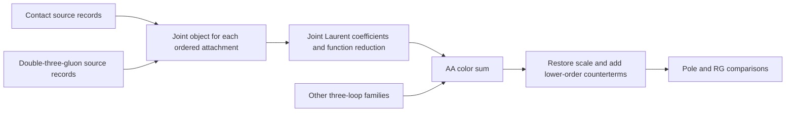

# Joint four-leg objects for the three-loop AA channel

Adopted 2026-10-24 at the user's request; WILSON-2.12.

The unit of four-leg reporting and AA assembly is the **ordered external attachment**, with the four-gluon contact contribution and all double-three-gluon exchange channels combined. The existing notation is retained: `I_2344`, for example, denotes the complete four-leg object attached to edges 2, 3, 4, 4, with the original ordering on edge 4. The two internal graph families remain source identifiers beneath this object.

Here "same topology" means the same external attachment and ordered domain. The internal contact and exchange trees are different terms in the same connected four-leg kernel. The [unified effective vertex](../../theory/four-leg-unified-20261022/derivation.md) supplies this integral-level definition. This convention does not group distinct Wilson attachment orderings solely by their leg counts.

## Nine objects and their source records

FGV denotes `4e-4g`; DT denotes `4e-3g+3g`. Every term below is the **selected normalized physical I**, with its physical sign, orbit/crossing factors and Euler compensation already included, and the common color/coupling/external scale removed. Each listed nonzero term has relative coefficient +1.

| Object | Sum of selected physical I contributions | Zero source records retained in the provenance |
|---|---|---|
| 3444 | DT01 + DT03 | FGV01: Lorentz zero; DT02: color zero |
| 3344 | FGV02 + DT04 + DT06 | DT05: color zero |
| 3334 | DT07 + DT09 | FGV03: Lorentz zero; DT08: color zero |
| 2444 | DT10 + DT12 | FGV04: Lorentz zero; DT11: color zero |
| 2344 | FGV05 + DT13 + DT15 | DT14: color zero |
| 2334 | FGV06 + DT16 + DT18 | DT17: color zero |
| 2244 | FGV07 + DT19 + DT21 | DT20: color zero |
| 2234 | FGV08 + DT22 + DT24 | DT23: color zero |
| 1234 | FGV09 + DT25 | DT26: color zero; DT25 already includes the rotated second channel |

The [original grouping audit](../../theory/four-leg-tree-grouping-20261021/derivation.md) covers all 9 FGV and 26 DT source orbits. After the specified Wilson color trace and tangent contraction there are 23 nonzero source records and 12 zero records. This change replaces their separate presentation by nine joint entries; it creates no new source graphs.

At the open color-tensor level the contact term and all three exchange pairings remain present. The X-pairing zero applies after the specified Wilson color trace. A vanishing contact term also does not make its whole attachment group vanish.

## Normalization and summation

Use the [FGV selector](../../fgv/4e-4g/current.json) and [DT selector](../../double-tgv/4e-3g+3g/current.json) to bind source revisions. In particular, the three-edge groups obey

```math
I_C=-\frac{G_2}{8}\mathscr C_\epsilon[J_C],\qquad
I_S=-\frac{G_2}{32}\mathscr C_\epsilon[J_S],\qquad
I_N=+\frac{G_2}{32}\mathscr C_\epsilon[J_N],
```

```math
G_2=e^{-3\gamma_E\epsilon}\Gamma(2-3\epsilon),\qquad
\mathscr C_\epsilon[J]=
\frac{J(z,\epsilon)+z^{3\epsilon}J(1/z,\epsilon)}{1+z^{3\epsilon}}.
```

Thus raw J kernels carry relative weights (-4,-1,+1), whereas the normalized I contributions add with weights (1,1,1). Their [normalization bridge](../../theory/four-leg-remaining-groups-20261023/derivation.md) must accompany any move between these levels. Do not apply the raw-J weights, color factors or orbit multiplicities a second time to the selected I values.

For 1234 the selected DT25 already includes S and its rotated N image:

```math
I_{1234}=I_{\mathrm{FGV09}}+I_{\mathrm{DT25}}.
```

There is no extra factor of two on DT25. A calculation with separate labeled S/N kernels must instead use the corresponding uncombined orbit normalization.

The four-leg contribution to the scale-stripped AA coefficient is

```math
U_{3,AA}^{\mathrm{four\ legs}}=\sum_{g\in\mathcal G_4}I_g,
\qquad
\mathcal G_4=\{3444,3344,3334,2444,2344,2334,2244,2234,1234\}.
```

The [established reflection relations](../../theory/four-leg-contour-sum-20261023/derivation.md) permit the equivalent compact sum

```math
U_{3,AA}^{\mathrm{four\ legs}}
=2I_{3444}+I_{3344}+I_{2444}+2I_{2344}+I_{2334}+I_{2244}+I_{1234}.
```

The factors two count the paired groups 3444/3334 and 2344/2234, respectively. The nine-entry source map remains available. This is the four-leg part of AA; the other three-loop families still contribute to the full AA sum. Once each source orbit has entered its joint object, the AA total must consume that object once and exclude those same individual orbits from any separate family subtotal.

## Result language and current gaps

Each joint entry should give its definition, source revisions, Laurent coefficients, and the matching Hlog/GPL and compact-function representations. Use the existing M, N, tau and E definitions, including their normalization and reflection conventions; a change of display symbol does not establish an identity. The [function definitions](../../theory/four-leg-2344-finite-20261023/web-function-definitions.md) distinguish the Euler function E(z) from Euler compensation factors.

Combination comes before compact-basis reduction. There is already concrete evidence for the benefit: 2244 has no explicit rational-z prefactors through the finite term; the known poles of 2344/2234 reduce to constant-coefficient M/N/zeta expressions and no longer require the separate A4 primitive. The [joint-coefficient analysis](../../theory/four-leg-remaining-groups-20261023/derivation.md) states exactly which orders have been checked. Universal closure in M/N/tau/E, or the disappearance of tau/E from every object, remains unproved.

| Joint object | Selected coefficient coverage and outstanding work |
|---|---|
| 3444, 3344, 3334, 2444, 2244 | Target Laurent coefficients through the finite term are available; use the existing group reductions where established. |
| 2344 and 2234 | Complete through epsilon0. The complete joint result and current C/S recover selected DT15 r013 and DT24 r007; the earlier finite-candidate warning is historical. The 55-word individual finite coefficients and old F1 reflection fold are audited in the [2026-10-29 recovery](../../../workflow/checks/dt15-24-recovery-20261029/README.md). Original numerical/formal limitations remain separately recorded. |
| 2334 | Complete through epsilon^0 with selected DT16 ibp-progress-r007, DT18 r001 and FGV06 r003. Joint finite term:54 constant-coefficient HLOG words, alphabet0/−1, weight≤6. Exact original negative-one boundary and five-point full source-connected finite-representation checks passed; rigorous original multidimensional error remains open. [Evidence](../../../workflow/checks/four-leg-2334-physical-finite-20261029/README.md). |
| 1234 | Selected coefficients through the finite term exist in GPL/algebraic-Chen special-value form. Conversion to the requested compact language remains a separate task. |

Subsequent reports should therefore describe the missing result as a joint-object coefficient, with DT15/24 or DT16 cited as its source-level origin. Known contributions within an incomplete object remain included; missing coefficients remain named unknown functions.

## Route into the AA checks



The next AA calculation first binds these nine objects to the selected coefficients, combines each known Laurent order, and then assembles all AA families through epsilon^-2. The cusp comparison can proceed at that order. The joint 2334 single pole remains explicit in subsequent constraints; unknown finite functions do not prevent the pole checks.

This document fixes the reporting and assembly interface. It does not record a newly evaluated AA sum or a new RG pass. The [alignment check and source map](../../../workflow/checks/four-leg-reporting-20261024/README.md) verify coverage and preserve the existing scientific inputs. The ongoing integral work and its acceptance status remain with their original tasks.

2026-10-29 update: the 2334 single-pole and finite coefficients are complete and its DT16 source revision is selected. The older “next AA calculation” paragraph above describes the original interface stage. No historical AA/RG output is recomputed or rebound by this update; the next consumer must use the new revision once and remove the former DT16-unknown placeholder. Other groups and compact-basis questions retain their separately recorded status.

2026-10-29 subsequent update: DT15 r013 and DT24 r007 now select the full physical coefficients through epsilon0, recovered from completed2344/2234. The double-TGV family has17/17 nonzero orbits and119/119 target Laurent positions. Its historical17/19 and13/19 IBP partial decompositions remain distinct. Future AA assembly must bind these new revisions explicitly or consume their joint objects once; no existing sum or RG check is recomputed here.
