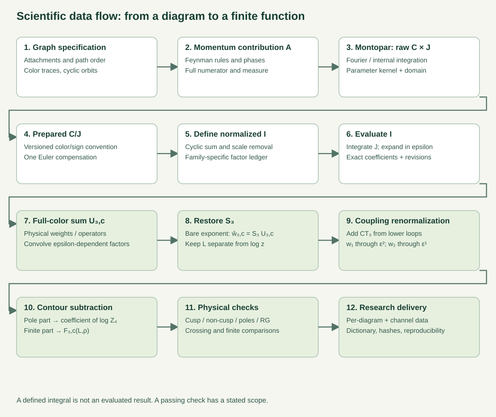
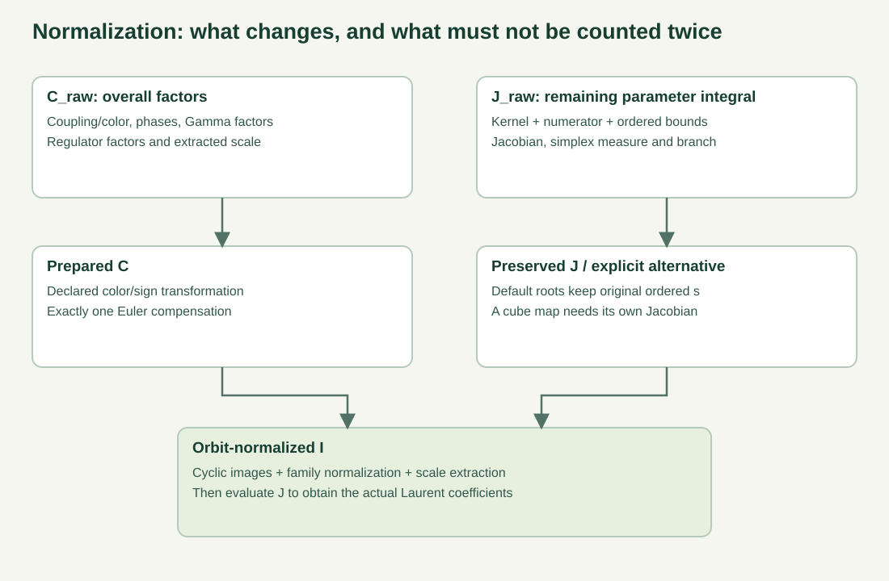
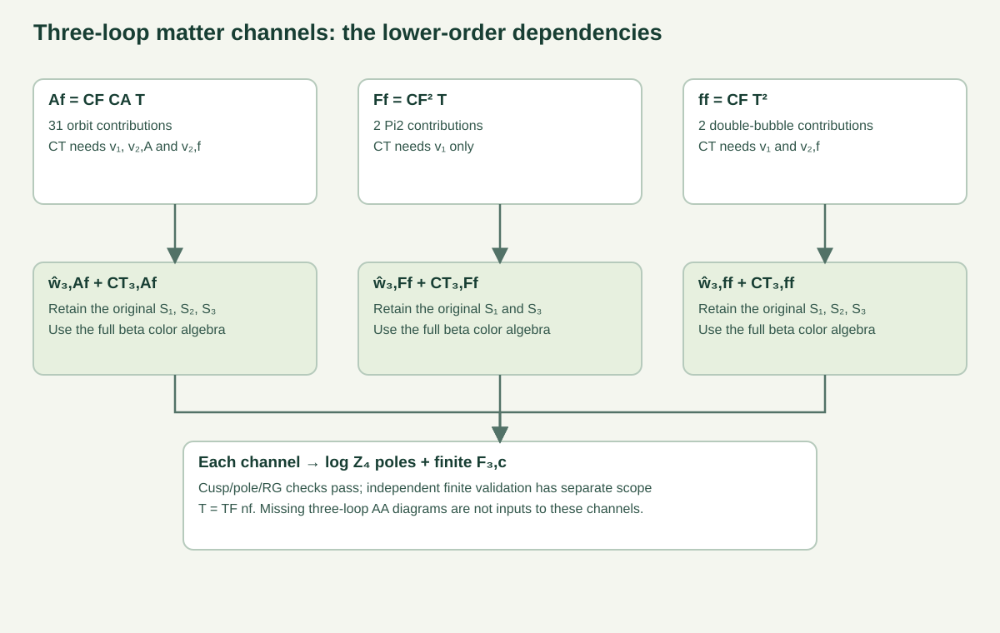

# 我们到底在算什么：从图到有限结果

[English illustrated guide](README.md) · [三色结果](../../results/2026-10-23/index.md)

整个项目的主线是：给定一个光状四边形 Wilson 回路，把每张图的贡献真正积出来，再按物理颜色组装，做重整化，最后得到有限函数和反常量纲。途中出现的 C、J、I、w、F 不是同一个量的随意改名，它们承担不同职责。

先沿图的每行从左到右看，再跟随箭头进入下一行。特别注意中间的两步：**定义 I** 和 **求出 I**。这两步分开，才能判断我们的计算究竟推进到了哪里。

## 从一张图开始

生成图时，不只是画几条线，还要确定 Wilson 端点在哪条边、同边端点的先后顺序、内部顶点如何连接、颜色迹的顺序和组合倍数。项目中经过审计的两圈路径是组合生成器，再做循环轨道分类和定义导出；虽然软件叫 qgraf-pipeline，不能因此说成每一步都运行了 QGRAF 二进制。

循环等价的图合成一个轨道，但镜像关系另行记录。两圈得到 6 张交换代表、4 张三胶子顶点代表和 2 张自能代表，共 12 个轨道。轨道代表不是随意挑出的示意图，而是带着原始积分定义的结构化输入。

## Montopar 的 C 和 J 是什么？

图加上费曼规则给出完整贡献 A。Montopar 做 Fourier 变换、内部子图积分或参数化，把它写成

\[
\mathcal A_r=C_{r,\mathrm{raw}}J_{r,\mathrm{raw}}.
\]

C 放不依赖剩余积分变量的整体因子，例如耦合、颜色、相位、Gamma 函数和提取出的尺度。J 是剩余的参数积分，包含分子、分母幂、积分域、测度和积分顺序。文件里出现 `J.integrand`，只表示被积函数已经构造出来，**并不表示这个积分已经算完**。

如果分部积分把一张图拆成很多项，表达式变成 \(\sum_t C_tJ_t\)。此时 `combined_C` 已经带上全局因子，不能再乘一次 C；边界项也不能随意丢掉。

## 为什么还有 prepared 和 I？

原始 C/J 要转换到下游统一采用的输入约定，这就是 preparation。它记录颜色转换、符号和一次 Euler 补偿，同时保留来源。默认的 47 个纯交换根使用原始有序参数，不默认把它们当成互相独立的超立方积分。

这里默认输入的 a1 投影与最终三圈的四个物理颜色通道，是不同层的操作。完整颜色信息仍要保留给物理组装使用。其他顶点、自能族也各有输入契约，不能把全部图都套成同一条 preparation 公式。

I 则是适合后续求和的逐轨道归一化积分。它按该图族的定义计入轨道/crossing、Euler 等因子，并提出公共颜色、耦合和外部尺度。因此，一旦手里已经是 I，不能再无条件乘 C、轨道倍数或 Euler 因子。

一个很具体的两圈例子是 `4e-01`。先真正算出

\[
J_{01}=\frac{z^{2\epsilon}}{4\epsilon^4}.
\]

然后用该交换族的轨道归一化，得到

\[
I_{01}=-\frac{e^{-2\gamma_E\epsilon}\Gamma(1-\epsilon)^2}{16\epsilon^4}.
\]

现在展开它，才能得到每个 Laurent 系数。这说明我们要交付给教授的“每图解析结果”，应该是已经求值的系数，而不仅是定义这些系数的积分。

## 从每个 I 到颜色通道

每张图得到

\[
I_r=\sum_p a_{r,p}(z)\epsilon^p.
\]

系数可以写成 Hlog，也可以写成 M、N 或更扩展的函数。函数表示和颜色分类是两回事；相同函数也可能出现在不同颜色通道中。

接下来，用完整物理颜色和源定义给出的权重组装

\[
U_{3,c}=\sum_r q_{r,c}(\epsilon)I_r.
\]

如果权重依赖 epsilon，就必须把它也展开并卷积，不能只乘它在 epsilon=0 时的值。有些自能数据已经是颜色加权后的系数，此时也不能再乘一次。

我们计算的是 log W 的系数。已经按 web/指数颜色形成 w 的输入，不要再次执行从 W 到 log W 的减乘积操作。

三圈的四个颜色是

\[
C_FC_A^2,\quad C_FC_AT_Fn_f,\quad C_F^2T_Fn_f,\quad C_F(T_Fn_f)^2.
\]

目前交付的三个物质通道覆盖 31 个不同轨道、35 个颜色贡献。两个数字不同，是因为链和 Pi2 图分别贡献到不止一个颜色中。

## 裸和之后还不能直接叫物理有限项

U 提出了外尺度，还要恢复 \(S_3\)，得到尺度完整的裸量 \(\widehat w_3=S_3U_3\)。S3 的 epsilon 展开会把极点系数带入有限项，因此“把各图 epsilon 零阶直接相加”不等于最终有限结果。

再用一圈、两圈输入加入三圈耦合反项：

\[
\widetilde w_3=\widehat w_3-\frac{2b_0}{\epsilon}\widehat w_2
+\left(\frac{b_0^2}{\epsilon^2}-\frac{b_1}{2\epsilon}\right)\widehat w_1.
\]

这也解释了为什么三圈有限项需要一圈到 epsilon 平方、两圈到 epsilon 一次、三圈到 epsilon 零次。各圈保留自己的尺度因子 S1、S2、S3。

三个物质色不依赖缺失的三圈纯胶子图，所以可以先完成；但它们依赖低圈输入，不能理解为完全不依赖其他计算。

最后把 \(\widetilde w_3\) 的极点归入 log Z4，留下有限函数 \(F_3(L,\rho)\)。再设 L=0 才得到形状函数 f3；进一步设 z=1 才得到某个数值。因此，“const term”必须说明是哪一阶段的 epsilon 零阶，不能把它和颜色通道数量混为一谈。

## 怎样理解我们已经完成的成果？

两圈已完成逐图、颜色组装、重整化，并与同一定义下的独立完整有限结果比较。三圈三个物质色也已经有完整的解析有限函数，且通过尖角反常量纲、极点结构和有限 RG 检查。它们的总量到这一阶用 M/N 就够了，不必人为引入 tau 或 E。

三圈还缺的验证是：Af 完整有限项的另一条原始输入重建，以及同一定义下的外部完整有限量比较。ff/Ff 已有独立原输入重建的历史证据。尖角检验本身不能排除给有限项加一个与 L 无关的偶函数，所以检查通过与所有有限项验证都完成，仍要区别。

纯胶子 AA 的直接逐图缺项则是双 TGV 15/24 的有限项，以及 16 的单极点和有限项；15/24 通过反射共享一个缺项。25 的紧凑基底约化另算，不应误列成缺失有限结果。利用 QCD/N4 总量关系得到的信息也不等于这些图已经分别求完。

整个链条旁边还有证明与版本记录：Markdown 推导、CAS 结果、MCP 步骤、适用时的 Lean 收据和固定文件哈希。它们说明推导过程、采用版本和检查范围，不能因为某个脚本返回成功，或者一个整理任务标为 Done，就把整个原积分称为形式证明完成。

对教授而言，先看这份流程，再看 `diagram-ledger.json` 的每图数据，最后看 `coefficients.json` 的颜色裸和、反项和有限量，就能清楚地知道每个公式从哪里来，以及它承担哪一步的作用。
