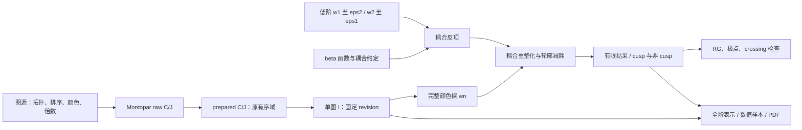

# Wilson 科学计算数据流

这张图描述依赖，不授予任何数学完成状态。默认 47 根的求解与完整物理颜色组装使用不同的颜色信息；两者在明确的归一化/颜色连接处衔接。

## 各阶段的输入与责任

| 阶段 | 输入 → 输出及执行入口 | 采用版本与验证边界 |
|---|---|---|
| 图源 | `qgraf-pipeline` 产生轨道、`orbit_definitions.json` 和 `integrals.json` | [安装源](project-index/upstream.json) 与 [已冻结三圈源](checks/w3-p0/sources/qgraf/3loop/) 分开；当前 dirty 源不能仅靠 HEAD 代表旧输出。尚无全 QCD 图集完备性定理 |
| raw C/J | Montopar 从图的有序端点与 Feynman 规则生成 C、J；[I/O 合同](../benchmarks/theory/montopar/io-contract.md) | 各族 sources 的 sha256/生成代码是采用依据。raw 通常未包含下游固定投影、Euler、C4 提取；以该族清单为准，不能泛化为所有包 |
| prepared C/J | [preprocessing](../preprocessing/README.md) 从有序快照生成默认 2e/4e/6e | [manifest 0.3](../benchmarks/2ne/prepared/manifest.json)：共 47 根；保留原 s、依赖边界、outer-to-inner 次序。不是超立方旧输入，也未证明 Fubini/product-measure 连接 |
| 单图 I | 求解工作区 Markdown + CAS/已有数学证据；不可变 `results/<id>/<revision>.json` | J→I 中的整体因子、域、branch、C4/crossing 及余项须与该结果一致。原定义和原收据不能因新表示而自动迁移 |
| 裸 wn | 单图 I × 原图完整颜色/物理权重 × 该圈外尺度和 | [三圈旧账本](../benchmarks/renormalization/three-loop/assembly-ledger.md) 与 [31 图物质输入](checks/w3-ca-nf/inputs.json)。a1 单图标签不能替代完整颜色向量/算符；旧账本需按修订选择更新后才能生成新结果 |
| 反项与轮廓减除 | beta、低阶 wn 和三圈裸项 → 代入重整化耦合，再拆 log Z4 与有限 log WR | [counterterms-r001](../benchmarks/renormalization/three-loop/counterterms-r001.json)、[一圈](../benchmarks/renormalization/one-loop/result-r001.json)、[两圈 eps¹](../benchmarks/renormalization/three-loop/lower-order-inputs-r001.json)。保留各自 S1/S2/S3，不给反项统一乘 S3 |
| 有限量/异常维数/RG | 有限量与极点模板、尺度导数、cusp 参考等交叉比较 | [物质颜色 r001](../benchmarks/renormalization/three-loop/results/CF-CA-TF-nf/r001.json) 和原 evidence；导出或索引通过不构成独立物理证明 |
| 相关展示与研究 | 固定输入/系数 → 全阶生成函数、样本和 PDF | 表示等价、数值字段、排版验收分开登记。新全阶研究不自动更新旧 Laurent 结果；PDF 别名须能追到完整源稿/验收 |

## 只在明确的一层计入因子

默认 47 根的颜色投影是先在完整固定基底中按 `CA²=1+2 CA CF` 重构，再取 a1。它不是大 N 极限，也不是在表达式中搜索 `CA² CF`。prepared C 在 Gamma 次数核验后只包含一次 `exp(-n EulerGamma eps)`；已有 I 的 Euler 补偿不在组装时重复。

原 raw 源的轨道计数、C4 倍数与 crossing 不是同一个量。逐图 I 是否已经包含 C4/crossing，以该结果 normalization/definition 和源连接为准。31 图历史组装明确采用已经包含 C4/web 与 Euler 的 I，只恢复公共外尺度。不要再次乘轨道倍数、crossing 或 a1。

物理符号有两个合法但不同的版本：历史 TGV 腿/Gamma1 I 使用旧顺序，31 图输入中显式乘 -1；原生符号生产 r002 将相应符号迁入 C/J，组装符号为 +1。连接依据是 [physical-bridge](checks/w3-ca-nf/physical-bridge.json) 及 [native-assembly-check](checks/shared-sign-production/native-assembly-check.json) 的 31 图/217 系数比较。不能把旧 -1 再施加到原生 I。Gamma1 r003 的解析复用还需要实际系数字段与 r002 相同；索引对此只作字面字段比较，不替代原符号桥。

普通展开若定义 `W=1+λW1+λ²W2+λ³W3+…`，则 `log W=λw1+λ²w2+λ³w3+…` 满足 `w1=W1`、`w2=W2−W1²/2`、`w3=W3−W1W2+W1³/3`。已经按 web/指数颜色组装为 wn 的输入不再次执行这一步。须先从源合同确认当前产物是 Wn 还是 wn。

## 三圈有限项的展开预算

本项目记录的耦合参数为 `λ=alpha_s/pi`。反项中的 `1/eps² × w1` 和 `1/eps × w2` 使三圈有限项需要：

| 独立输入 | 必需最高阶 | 采用入口 |
|---|---:|---|
| 一圈 w1 | eps² | `one-loop/result-r001.json:/laurent_unit_coefficients` |
| 两圈 w2 | eps¹ | `three-loop/lower-order-inputs-r001.json:/hat_w2_over_CF` |
| 三圈裸 w3 | eps⁰ | 31 图输入及各颜色裸组装 |

索引验证字段中实际列出的幂；只对源明确给出的最高极点以下补“已知零”的预算含义，不补缺失的正阶。新增未消费的 eps³ 系数不会让只读到 eps² 的旧反项失效；其他字段/未知变换的影响标为“需要复核”。

## 版本修订的解释

2026-10-17 已另建[当前物质颜色字段与 RG 核验](checks/matter-rg-20261017/README.md)：三个通道共 452 项检查通过，31 图当前解析字段与旧物理输入逐项连接，另外两色从当前来源重建。原 r001 和旧哈希绑定不改写；CFCA 的完整 r→z 求和仍复用原 HyperInt 证据。这不增加独立 h3/有限形状验证或形式证明。

后续[原 C/J 独立重建](checks/matter-independent-20261017/README.md)补上 nf2/cff 的一般正 z 有限形状，Af 未覆盖。外部因子化 Γ 的算术对照另有[日志尺度勘误](../benchmarks/renormalization/theory/matter-independent-20261017/derivation-r002.md)：几何日志的 log2 字典尚未闭合，不能据算术相等宣布独立物理验证完成。这一新增缺口不改写上段内部 RG 的原版本与范围。

- 旧检查始终绑定旧文件哈希；current 更新只是改变采用入口。
- 双 TGV 13/22 的 r002 改变了 eps⁻³ 至 eps⁰，登记到纯 `CF*CA²` 消费者及尚未完成的组装目标；31 图物质支路没有这两图。
- Gamma1 03/04 的 r003 改变附属数值样本。解析 I/J 与归一化相同时，可结合已有符号桥复用解析结果；报告中的数值表需要使用新样本。
- 缺少逐字段连接时只能报告需要复核；索引没有边，不能被当作数学独立性的证明。

索引实现、查询语法与缺口处理见 [管理工具说明](project-management.md)。
