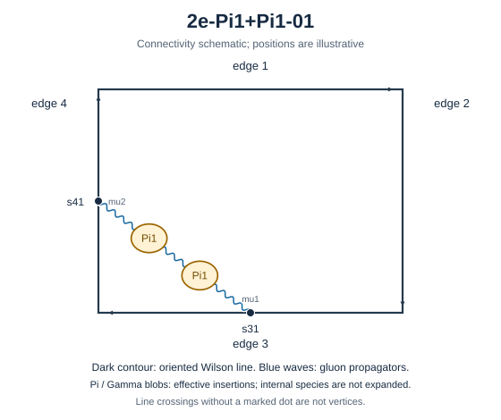

# 2e-Pi1+Pi1-01



Family: chain. Native Hlog arguments and the integral meaning of `rho` are retained. The scale logarithm L enters only after multiplying the sum by S3.

[Original source result](../../results/2026-10-23/sources/benchmarks/self-energy/pi1-chain/results/2e-Pi1+Pi1-01/r002.json) · [Complete raw ledger](../../results/2026-10-23/diagram-ledger.json) · [Conventions](conventions.md)

## Native coefficients

The exact original field, zero provenance and raw syntax are recorded in `native_unweighted` in the ledger. The normalized expressions below do not apply a new r-to-z transformation.

### Native coefficient of $`\epsilon^{-6}`$

```math

0

```

### Native coefficient of $`\epsilon^{-5}`$

```math

0

```

### Native coefficient of $`\epsilon^{-4}`$

```math

- \frac{1}{576}

```

### Native coefficient of $`\epsilon^{-3}`$

```math

- \frac{5}{1152}

```

### Native coefficient of $`\epsilon^{-2}`$

```math

- \frac{1}{64} - \frac{\pi^{2}}{2304}

```

### Native coefficient of $`\epsilon^{-1}`$

```math

- \frac{5}{144} - \frac{7 \zeta\left(3\right)}{576} - \frac{5 \pi^{2}}{4608}

```

### Native coefficient of $`\epsilon^{0}`$

```math

- \frac{7}{72} - \frac{\pi^{2}}{256} - \frac{35 \zeta\left(3\right)}{1152} - \frac{67 \pi^{4}}{276480}

```

## Af color-weighted contribution

Each coefficient is after the declared external multiplier/convolution and before S3.

### Weighted coefficient of $`\epsilon^{-6}`$

```math

0

```

### Weighted coefficient of $`\epsilon^{-5}`$

```math

0

```

### Weighted coefficient of $`\epsilon^{-4}`$

```math

\frac{5}{162}

```

### Weighted coefficient of $`\epsilon^{-3}`$

```math

\frac{67}{972}

```

### Weighted coefficient of $`\epsilon^{-2}`$

```math

\frac{5 \pi^{2}}{648} + \frac{61}{243}

```

### Weighted coefficient of $`\epsilon^{-1}`$

```math

\frac{67 \pi^{2}}{3888} + \frac{35 \zeta\left(3\right)}{162} + \frac{4577}{8748}

```

### Weighted coefficient of $`\epsilon^{0}`$

```math

\frac{67 \pi^{4}}{15552} + \frac{469 \zeta\left(3\right)}{972} + \frac{61 \pi^{2}}{972} + \frac{19597}{13122}

```

## ff color-weighted contribution

Each coefficient is after the declared external multiplier/convolution and before S3.

### Weighted coefficient of $`\epsilon^{-6}`$

```math

0

```

### Weighted coefficient of $`\epsilon^{-5}`$

```math

0

```

### Weighted coefficient of $`\epsilon^{-4}`$

```math

- \frac{1}{81}

```

### Weighted coefficient of $`\epsilon^{-3}`$

```math

- \frac{11}{486}

```

### Weighted coefficient of $`\epsilon^{-2}`$

```math

- \frac{7}{81} - \frac{\pi^{2}}{324}

```

### Weighted coefficient of $`\epsilon^{-1}`$

```math

- \frac{703}{4374} - \frac{7 \zeta\left(3\right)}{81} - \frac{11 \pi^{2}}{1944}

```

### Weighted coefficient of $`\epsilon^{0}`$

```math

- \frac{3179}{6561} - \frac{7 \pi^{2}}{324} - \frac{77 \zeta\left(3\right)}{486} - \frac{67 \pi^{4}}{38880}

```

