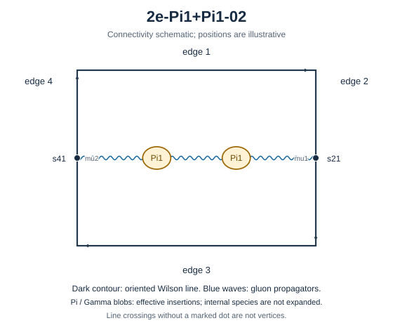

# 2e-Pi1+Pi1-02



Family: chain. Native Hlog arguments and the integral meaning of `rho` are retained. The scale logarithm L enters only after multiplying the sum by S3.

[Original source result](../../results/2026-10-23/sources/benchmarks/self-energy/pi1-chain/results/2e-Pi1+Pi1-02/r002.json) · [Complete raw ledger](../../results/2026-10-23/diagram-ledger.json) · [Conventions](conventions.md)

## Native coefficients

The exact original field, zero provenance and raw syntax are recorded in `native_unweighted` in the ledger. The normalized expressions below do not apply a new r-to-z transformation.

### Native coefficient of $`\epsilon^{-6}`$

```math

0

```

### Native coefficient of $`\epsilon^{-5}`$

```math

0

```

### Native coefficient of $`\epsilon^{-4}`$

```math

0

```

### Native coefficient of $`\epsilon^{-3}`$

```math

- \frac{1}{384}

```

### Native coefficient of $`\epsilon^{-2}`$

```math

\frac{\rho^{2}}{256} - \frac{1}{192} + \frac{\pi^{2}}{256}

```

### Native coefficient of $`\epsilon^{-1}`$

```math

\begin{aligned}& - \frac{3 \pi^{2} G(-1;z)}{256} - \frac{3 G(-1,0,0;z)}{128} + \frac{\rho^{3}}{512} + \frac{\rho^{2}}{64} + \frac{3 \pi^{2} \rho}{512} - \frac{3 \zeta\left(3\right)}{128}\\ & {} - \frac{1}{48} + \frac{23 \pi^{2}}{1536}\end{aligned}

```

### Native coefficient of $`\epsilon^{0}`$

```math

\begin{aligned}& - \frac{9 \pi^{2} G(0,-1;z)}{512} - \frac{9 G(0,-1,0,0;z)}{256} - \frac{3 \pi^{2} G(-1;z)}{64} + \frac{9 G(-1;z) \zeta\left(3\right)}{128}\\ & {} - \frac{9 \pi^{2} G(-1,0;z)}{512} - \frac{3 G(-1,0,0;z)}{32} - \frac{9 G(-1,0,0,0;z)}{256} + \frac{9 \pi^{2} G(-1,-1;z)}{256} + \frac{9 G(-1,-1,0,0;z)}{128}\\ & {} - \frac{3 \rho^{4}}{1024} + \frac{\rho^{3}}{128} + \frac{\pi^{2} \rho^{2}}{1024} + \frac{3 \rho^{2}}{64} - \frac{9 \rho \zeta\left(3\right)}{256}\\ & {} + \frac{3 \pi^{2} \rho}{128} - \frac{43 \zeta\left(3\right)}{384} - \frac{1}{24} + \frac{17 \pi^{4}}{5120} + \frac{35 \pi^{2}}{768}\end{aligned}

```

## Af color-weighted contribution

Each coefficient is after the declared external multiplier/convolution and before S3.

### Weighted coefficient of $`\epsilon^{-6}`$

```math

0

```

### Weighted coefficient of $`\epsilon^{-5}`$

```math

0

```

### Weighted coefficient of $`\epsilon^{-4}`$

```math

0

```

### Weighted coefficient of $`\epsilon^{-3}`$

```math

\frac{5}{108}

```

### Weighted coefficient of $`\epsilon^{-2}`$

```math

- \frac{5 \rho^{2}}{72} - \frac{5 \pi^{2}}{72} + \frac{13}{162}

```

### Weighted coefficient of $`\epsilon^{-1}`$

```math

\begin{aligned}& \frac{5 \pi^{2} G(-1;z)}{24} + \frac{5 G(-1,0,0;z)}{12} - \frac{5 \rho^{3}}{144} - \frac{7 \rho^{2}}{27} - \frac{5 \pi^{2} \rho}{48} - \frac{107 \pi^{2}}{432}\\ & {} + \frac{109}{324} + \frac{5 \zeta\left(3\right)}{12}\end{aligned}

```

### Weighted coefficient of $`\epsilon^{0}`$

```math

\begin{aligned}& \frac{5 \pi^{2} G(0,-1;z)}{16} + \frac{5 G(0,-1,0,0;z)}{8} - \frac{5 G(-1;z) \zeta\left(3\right)}{4} + \frac{7 \pi^{2} G(-1;z)}{9} + \frac{5 \pi^{2} G(-1,0;z)}{16}\\ & {} + \frac{14 G(-1,0,0;z)}{9} + \frac{5 G(-1,0,0,0;z)}{8} - \frac{5 \pi^{2} G(-1,-1;z)}{8} - \frac{5 G(-1,-1,0,0;z)}{4} + \frac{5 \rho^{4}}{96} - \frac{7 \rho^{3}}{54}\\ & {} - \frac{161 \rho^{2}}{216} - \frac{5 \pi^{2} \rho^{2}}{288} - \frac{7 \pi^{2} \rho}{18} + \frac{5 \rho \zeta\left(3\right)}{8} - \frac{235 \pi^{2}}{324}\\ & {} - \frac{17 \pi^{4}}{288} + \frac{899}{1458} + \frac{203 \zeta\left(3\right)}{108}\end{aligned}

```

## ff color-weighted contribution

Each coefficient is after the declared external multiplier/convolution and before S3.

### Weighted coefficient of $`\epsilon^{-6}`$

```math

0

```

### Weighted coefficient of $`\epsilon^{-5}`$

```math

0

```

### Weighted coefficient of $`\epsilon^{-4}`$

```math

0

```

### Weighted coefficient of $`\epsilon^{-3}`$

```math

- \frac{1}{54}

```

### Weighted coefficient of $`\epsilon^{-2}`$

```math

\frac{\rho^{2}}{36} - \frac{2}{81} + \frac{\pi^{2}}{36}

```

### Weighted coefficient of $`\epsilon^{-1}`$

```math

\begin{aligned}& - \frac{\pi^{2} G(-1;z)}{12} - \frac{G(-1,0,0;z)}{6} + \frac{\rho^{3}}{72} + \frac{5 \rho^{2}}{54} + \frac{\pi^{2} \rho}{24} - \frac{\zeta\left(3\right)}{6}\\ & {} - \frac{19}{162} + \frac{19 \pi^{2}}{216}\end{aligned}

```

### Weighted coefficient of $`\epsilon^{0}`$

```math

\begin{aligned}& - \frac{\pi^{2} G(0,-1;z)}{8} - \frac{G(0,-1,0,0;z)}{4} - \frac{5 \pi^{2} G(-1;z)}{18} + \frac{G(-1;z) \zeta\left(3\right)}{2} - \frac{\pi^{2} G(-1,0;z)}{8}\\ & {} - \frac{5 G(-1,0,0;z)}{9} - \frac{G(-1,0,0,0;z)}{4} + \frac{\pi^{2} G(-1,-1;z)}{4} + \frac{G(-1,-1,0,0;z)}{2} - \frac{\rho^{4}}{48} + \frac{5 \rho^{3}}{108}\\ & {} + \frac{\pi^{2} \rho^{2}}{144} + \frac{\rho^{2}}{4} - \frac{\rho \zeta\left(3\right)}{4} + \frac{5 \pi^{2} \rho}{36} - \frac{37 \zeta\left(3\right)}{54}\\ & {} - \frac{133}{729} + \frac{17 \pi^{4}}{720} + \frac{79 \pi^{2}}{324}\end{aligned}

```

