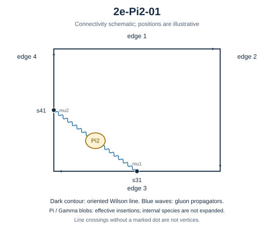

# 2e-Pi2-01



Family: Pi2. Native Hlog arguments and the integral meaning of `rho` are retained. The scale logarithm L enters only after multiplying the sum by S3.

[Original source result](../../results/2026-10-23/sources/benchmarks/self-energy/pi2/results/2e-Pi2-01/r002.json) · [Complete raw ledger](../../results/2026-10-23/diagram-ledger.json) · [Conventions](conventions.md)

## Native coefficients

The exact original field, zero provenance and raw syntax are recorded in `native_unweighted` in the ledger. The normalized expressions below do not apply a new r-to-z transformation.

### Native coefficient of $`\epsilon^{-6}`$

```math

0

```

### Native coefficient of $`\epsilon^{-5}`$

```math

0

```

### Native coefficient of $`\epsilon^{-4}`$

```math

\frac{1}{576}

```

### Native coefficient of $`\epsilon^{-3}`$

```math

\frac{5}{1152}

```

### Native coefficient of $`\epsilon^{-2}`$

```math

\frac{\pi^{2}}{2304} + \frac{1}{64}

```

### Native coefficient of $`\epsilon^{-1}`$

```math

\frac{5 \pi^{2}}{4608} + \frac{7 \zeta\left(3\right)}{576} + \frac{5}{144}

```

### Native coefficient of $`\epsilon^{0}`$

```math

\frac{67 \pi^{4}}{276480} + \frac{35 \zeta\left(3\right)}{1152} + \frac{\pi^{2}}{256} + \frac{7}{72}

```

## Af color-weighted contribution

Each coefficient is after the declared external multiplier/convolution and before S3.

### Weighted coefficient of $`\epsilon^{-6}`$

```math

0

```

### Weighted coefficient of $`\epsilon^{-5}`$

```math

0

```

### Weighted coefficient of $`\epsilon^{-4}`$

```math

\frac{5}{432}

```

### Weighted coefficient of $`\epsilon^{-3}`$

```math

\frac{7}{324}

```

### Weighted coefficient of $`\epsilon^{-2}`$

```math

\frac{5 \pi^{2}}{1728} + \frac{\zeta\left(3\right)}{18} + \frac{199}{1944}

```

### Weighted coefficient of $`\epsilon^{-1}`$

```math

\frac{7 \pi^{2}}{1296} + \frac{7 \zeta\left(3\right)}{144} + \frac{\pi^{4}}{1080} + \frac{4751}{23328}

```

### Weighted coefficient of $`\epsilon^{0}`$

```math

\begin{aligned}& \frac{223 \pi^{4}}{207360} + \frac{\pi^{2} \zeta\left(3\right)}{72} + \frac{199 \pi^{2}}{7776} + \frac{7 \zeta\left(5\right)}{18} + \frac{73 \zeta\left(3\right)}{216}\\ & {} + \frac{97655}{139968}\end{aligned}

```

## Ff color-weighted contribution

Each coefficient is after the declared external multiplier/convolution and before S3.

### Weighted coefficient of $`\epsilon^{-6}`$

```math

0

```

### Weighted coefficient of $`\epsilon^{-5}`$

```math

0

```

### Weighted coefficient of $`\epsilon^{-4}`$

```math

0

```

### Weighted coefficient of $`\epsilon^{-3}`$

```math

\frac{1}{72}

```

### Weighted coefficient of $`\epsilon^{-2}`$

```math

\frac{23}{216} - \frac{\zeta\left(3\right)}{9}

```

### Weighted coefficient of $`\epsilon^{-1}`$

```math

- \frac{5 \zeta\left(3\right)}{27} - \frac{\pi^{4}}{540} + \frac{\pi^{2}}{288} + \frac{331}{648}

```

### Weighted coefficient of $`\epsilon^{0}`$

```math

\begin{aligned}& - \frac{557 \zeta\left(3\right)}{648} - \frac{7 \zeta\left(5\right)}{9} - \frac{\pi^{2} \zeta\left(3\right)}{36} - \frac{\pi^{4}}{324} + \frac{23 \pi^{2}}{864}\\ & {} + \frac{7993}{3888}\end{aligned}

```

