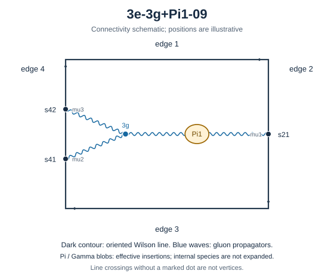

# 3e-3g+Pi1-09



Family: legs. Native Hlog arguments and the integral meaning of `rho` are retained. The scale logarithm L enters only after multiplying the sum by S3.

[Original source result](../../results/2026-10-23/sources/benchmarks/self-energy/tgv-pi1/results/3e-3g+Pi1-09/r003.json) · [Complete raw ledger](../../results/2026-10-23/diagram-ledger.json) · [Conventions](conventions.md)

## Native coefficients

The exact original field, zero provenance and raw syntax are recorded in `native_unweighted` in the ledger. The normalized expressions below do not apply a new r-to-z transformation.

### Native coefficient of $`\epsilon^{-6}`$

```math

0

```

### Native coefficient of $`\epsilon^{-5}`$

```math

0

```

### Native coefficient of $`\epsilon^{-4}`$

```math

\frac{1}{384}

```

### Native coefficient of $`\epsilon^{-3}`$

```math

- \frac{1}{96}

```

### Native coefficient of $`\epsilon^{-2}`$

```math

\begin{aligned}& \frac{\pi^{2} G(0;r)}{128} + \frac{G(0,0;r)}{32} + \frac{G(0,0,0;r)}{64} - \frac{G(0,0,1;r)}{64} - \frac{G(0,1;r)}{32} - \frac{G(0,1,0;r)}{64} + \frac{G(0,1,1;r)}{64}\\ & {} + \frac{\pi^{2} G(1;r)}{128} - \frac{G(1,0;r)}{32} + \frac{G(1,0,0;r)}{64} - \frac{G(1,0,1;r)}{64} + \frac{G(1,1;r)}{32} - \frac{G(1,1,0;r)}{64} + \frac{G(1,1,1;r)}{64}\\ & {} - \frac{\zeta\left(3\right)}{32} - \frac{1}{96} + \frac{31 \pi^{2}}{1536}\end{aligned}

```

### Native coefficient of $`\epsilon^{-1}`$

```math

\begin{aligned}& - G(0;r) \left(- \frac{5 \pi^{2}}{128} + \frac{\zeta\left(3\right)}{16}\right) - G(0,0;r) \left(- \frac{1}{8} - \frac{\pi^{2}}{128}\right) + \frac{5 G(0,0,0;r)}{64}\\ & {} + \frac{G(0,0,0,0;r)}{32} - \frac{G(0,0,0,1;r)}{32} - \frac{5 G(0,0,1;r)}{64} - \frac{G(0,0,1,0;r)}{32} + \frac{G(0,0,1,1;r)}{32}\\ & {} - G(0,1;r) \left(\frac{1}{8} - \frac{3 \pi^{2}}{128}\right) - \frac{5 G(0,1,0;r)}{64} + \frac{G(0,1,0,0;r)}{32} - \frac{G(0,1,0,1;r)}{32} + \frac{5 G(0,1,1;r)}{64}\\ & {} - \frac{G(0,1,1,0;r)}{32} + \frac{G(0,1,1,1;r)}{32} - G(1;r) \left(- \frac{5 \pi^{2}}{128} + \frac{\zeta\left(3\right)}{16}\right)\\ & {} - G(1,0;r) \left(\frac{1}{8} - \frac{3 \pi^{2}}{128}\right) + \frac{5 G(1,0,0;r)}{64} + \frac{G(1,0,0,0;r)}{32} - \frac{G(1,0,0,1;r)}{32} - \frac{5 G(1,0,1;r)}{64}\\ & {} - \frac{G(1,0,1,0;r)}{32} + \frac{G(1,0,1,1;r)}{32} - G(1,1;r) \left(- \frac{1}{8} - \frac{\pi^{2}}{128}\right) - \frac{5 G(1,1,0;r)}{64} + \frac{G(1,1,0,0;r)}{32}\\ & {} - \frac{G(1,1,0,1;r)}{32} + \frac{5 G(1,1,1;r)}{64} - \frac{G(1,1,1,0;r)}{32} + \frac{G(1,1,1,1;r)}{32} - \frac{53 \zeta\left(3\right)}{384} - \frac{1}{12}\\ & {} + \frac{\pi^{4}}{640} + \frac{23 \pi^{2}}{384}\end{aligned}

```

### Native coefficient of $`\epsilon^{0}`$

```math

\begin{aligned}& - G(0;r) \left(- \frac{\pi^{2}}{8} - \frac{19 \pi^{4}}{2560} + \frac{17 \zeta\left(3\right)}{64}\right)\\ & {} - G(0,0;r) \left(- \frac{3}{8} - \frac{3 \pi^{2}}{128} + \frac{\zeta\left(3\right)}{32}\right) - G(0,0,0;r) \left(- \frac{1}{4} + \frac{7 \pi^{2}}{256}\right)\\ & {} - \frac{7 G(0,0,0,0;r)}{32} - \frac{17 G(0,0,0,0,0;r)}{64} + \frac{17 G(0,0,0,0,1;r)}{64} + \frac{7 G(0,0,0,1;r)}{32} + \frac{17 G(0,0,0,1,0;r)}{64}\\ & {} - \frac{17 G(0,0,0,1,1;r)}{64} - G(0,0,1;r) \left(\frac{1}{4} - \frac{11 \pi^{2}}{256}\right) + \frac{7 G(0,0,1,0;r)}{32} + \frac{19 G(0,0,1,0,0;r)}{64}\\ & {} - \frac{19 G(0,0,1,0,1;r)}{64} - \frac{7 G(0,0,1,1;r)}{32} - \frac{19 G(0,0,1,1,0;r)}{64} + \frac{19 G(0,0,1,1,1;r)}{64}\\ & {} - G(0,1;r) \left(- \frac{7 \pi^{2}}{64} + \frac{11 \zeta\left(3\right)}{64} + \frac{3}{8}\right) - G(0,1,0;r) \left(\frac{1}{4} - \frac{11 \pi^{2}}{256}\right)\\ & {} + \frac{31 G(0,1,0,0;r)}{64} + \frac{5 G(0,1,0,0,0;r)}{32} - \frac{5 G(0,1,0,0,1;r)}{32} - \frac{31 G(0,1,0,1;r)}{64} - \frac{5 G(0,1,0,1,0;r)}{32}\\ & {} + \frac{5 G(0,1,0,1,1;r)}{32} - G(0,1,1;r) \left(- \frac{11 \pi^{2}}{256} - \frac{1}{4}\right) - \frac{31 G(0,1,1,0;r)}{64} + \frac{G(0,1,1,0,0;r)}{64}\\ & {} - \frac{G(0,1,1,0,1;r)}{64} + \frac{31 G(0,1,1,1;r)}{64} - \frac{G(0,1,1,1,0;r)}{64} + \frac{G(0,1,1,1,1;r)}{64}\\ & {} - G(1;r) \left(- \frac{\pi^{2}}{8} - \frac{19 \pi^{4}}{2560} + \frac{17 \zeta\left(3\right)}{64}\right)\\ & {} - G(1,0;r) \left(- \frac{7 \pi^{2}}{64} + \frac{11 \zeta\left(3\right)}{64} + \frac{3}{8}\right) - G(1,0,0;r) \left(- \frac{11 \pi^{2}}{256} - \frac{1}{4}\right)\\ & {} + \frac{31 G(1,0,0,0;r)}{64} + \frac{G(1,0,0,0,0;r)}{64} - \frac{G(1,0,0,0,1;r)}{64} - \frac{31 G(1,0,0,1;r)}{64} - \frac{G(1,0,0,1,0;r)}{64} + \frac{G(1,0,0,1,1;r)}{64}\\ & {} - G(1,0,1;r) \left(\frac{1}{4} - \frac{11 \pi^{2}}{256}\right) - \frac{31 G(1,0,1,0;r)}{64} + \frac{5 G(1,0,1,0,0;r)}{32} - \frac{5 G(1,0,1,0,1;r)}{32}\\ & {} + \frac{31 G(1,0,1,1;r)}{64} - \frac{5 G(1,0,1,1,0;r)}{32} + \frac{5 G(1,0,1,1,1;r)}{32}\\ & {} - G(1,1;r) \left(- \frac{3}{8} - \frac{3 \pi^{2}}{128} + \frac{\zeta\left(3\right)}{32}\right) - G(1,1,0;r) \left(\frac{1}{4} - \frac{11 \pi^{2}}{256}\right)\\ & {} - \frac{7 G(1,1,0,0;r)}{32} + \frac{19 G(1,1,0,0,0;r)}{64} - \frac{19 G(1,1,0,0,1;r)}{64} + \frac{7 G(1,1,0,1;r)}{32} - \frac{19 G(1,1,0,1,0;r)}{64}\\ & {} + \frac{19 G(1,1,0,1,1;r)}{64} - G(1,1,1;r) \left(- \frac{1}{4} + \frac{7 \pi^{2}}{256}\right) + \frac{7 G(1,1,1,0;r)}{32} - \frac{17 G(1,1,1,0,0;r)}{64}\\ & {} + \frac{17 G(1,1,1,0,1;r)}{64} - \frac{7 G(1,1,1,1;r)}{32} + \frac{17 G(1,1,1,1,0;r)}{64} - \frac{17 G(1,1,1,1,1;r)}{64} - \frac{55 \zeta\left(3\right)}{96}\\ & {} - \frac{3 \zeta\left(5\right)}{8} - \frac{\pi^{2} \zeta\left(3\right)}{64} - \frac{1}{8} + \frac{3571 \pi^{4}}{184320} + \frac{77 \pi^{2}}{384}\end{aligned}

```

## Af color-weighted contribution

Each coefficient is after the declared external multiplier/convolution and before S3.

### Weighted coefficient of $`\epsilon^{-6}`$

```math

0

```

### Weighted coefficient of $`\epsilon^{-5}`$

```math

0

```

### Weighted coefficient of $`\epsilon^{-4}`$

```math

- \frac{1}{144}

```

### Weighted coefficient of $`\epsilon^{-3}`$

```math

\frac{13}{432}

```

### Weighted coefficient of $`\epsilon^{-2}`$

```math

\begin{aligned}& - \frac{\pi^{2} G(0;r)}{48} - \frac{G(0,0;r)}{12} - \frac{G(0,0,0;r)}{24} + \frac{G(0,0,1;r)}{24} + \frac{G(0,1;r)}{12} + \frac{G(0,1,0;r)}{24} - \frac{G(0,1,1;r)}{24}\\ & {} - \frac{\pi^{2} G(1;r)}{48} + \frac{G(1,0;r)}{12} - \frac{G(1,0,0;r)}{24} + \frac{G(1,0,1;r)}{24} - \frac{G(1,1;r)}{12} + \frac{G(1,1,0;r)}{24} - \frac{G(1,1,1;r)}{24}\\ & {} - \frac{31 \pi^{2}}{576} + \frac{13}{648} + \frac{\zeta\left(3\right)}{12}\end{aligned}

```

### Weighted coefficient of $`\epsilon^{-1}`$

```math

\begin{aligned}& - \frac{7 \pi^{2} G(0;r)}{72} + \frac{G(0;r) \zeta\left(3\right)}{6} - \frac{11 G(0,0;r)}{36} - \frac{\pi^{2} G(0,0;r)}{48} - \frac{7 G(0,0,0;r)}{36}\\ & {} - \frac{G(0,0,0,0;r)}{12} + \frac{G(0,0,0,1;r)}{12} + \frac{7 G(0,0,1;r)}{36} + \frac{G(0,0,1,0;r)}{12} - \frac{G(0,0,1,1;r)}{12} - \frac{\pi^{2} G(0,1;r)}{16}\\ & {} + \frac{11 G(0,1;r)}{36} + \frac{7 G(0,1,0;r)}{36} - \frac{G(0,1,0,0;r)}{12} + \frac{G(0,1,0,1;r)}{12} - \frac{7 G(0,1,1;r)}{36} + \frac{G(0,1,1,0;r)}{12}\\ & {} - \frac{G(0,1,1,1;r)}{12} - \frac{7 \pi^{2} G(1;r)}{72} + \frac{G(1;r) \zeta\left(3\right)}{6} - \frac{\pi^{2} G(1,0;r)}{16} + \frac{11 G(1,0;r)}{36}\\ & {} - \frac{7 G(1,0,0;r)}{36} - \frac{G(1,0,0,0;r)}{12} + \frac{G(1,0,0,1;r)}{12} + \frac{7 G(1,0,1;r)}{36} + \frac{G(1,0,1,0;r)}{12} - \frac{G(1,0,1,1;r)}{12}\\ & {} - \frac{11 G(1,1;r)}{36} - \frac{\pi^{2} G(1,1;r)}{48} + \frac{7 G(1,1,0;r)}{36} - \frac{G(1,1,0,0;r)}{12} + \frac{G(1,1,0,1;r)}{12} - \frac{7 G(1,1,1;r)}{36}\\ & {} + \frac{G(1,1,1,0;r)}{12} - \frac{G(1,1,1,1;r)}{12} - \frac{245 \pi^{2}}{1728} - \frac{\pi^{4}}{240} + \frac{101}{486} + \frac{49 \zeta\left(3\right)}{144}\end{aligned}

```

### Weighted coefficient of $`\epsilon^{0}`$

```math

\begin{aligned}& - \frac{127 \pi^{2} G(0;r)}{432} - \frac{19 \pi^{4} G(0;r)}{960} + \frac{47 G(0;r) \zeta\left(3\right)}{72} - \frac{47 G(0,0;r)}{54} - \frac{\pi^{2} G(0,0;r)}{18}\\ & {} + \frac{G(0,0;r) \zeta\left(3\right)}{12} - \frac{127 G(0,0,0;r)}{216} + \frac{7 \pi^{2} G(0,0,0;r)}{96} + \frac{11 G(0,0,0,0;r)}{18} + \frac{17 G(0,0,0,0,0;r)}{24}\\ & {} - \frac{17 G(0,0,0,0,1;r)}{24} - \frac{11 G(0,0,0,1;r)}{18} - \frac{17 G(0,0,0,1,0;r)}{24} + \frac{17 G(0,0,0,1,1;r)}{24} - \frac{11 \pi^{2} G(0,0,1;r)}{96}\\ & {} + \frac{127 G(0,0,1;r)}{216} - \frac{11 G(0,0,1,0;r)}{18} - \frac{19 G(0,0,1,0,0;r)}{24} + \frac{19 G(0,0,1,0,1;r)}{24} + \frac{11 G(0,0,1,1;r)}{18}\\ & {} + \frac{19 G(0,0,1,1,0;r)}{24} - \frac{19 G(0,0,1,1,1;r)}{24} - \frac{13 \pi^{2} G(0,1;r)}{48} + \frac{11 G(0,1;r) \zeta\left(3\right)}{24} + \frac{47 G(0,1;r)}{54}\\ & {} - \frac{11 \pi^{2} G(0,1,0;r)}{96} + \frac{127 G(0,1,0;r)}{216} - \frac{91 G(0,1,0,0;r)}{72} - \frac{5 G(0,1,0,0,0;r)}{12} + \frac{5 G(0,1,0,0,1;r)}{12}\\ & {} + \frac{91 G(0,1,0,1;r)}{72} + \frac{5 G(0,1,0,1,0;r)}{12} - \frac{5 G(0,1,0,1,1;r)}{12} - \frac{11 \pi^{2} G(0,1,1;r)}{96} - \frac{127 G(0,1,1;r)}{216}\\ & {} + \frac{91 G(0,1,1,0;r)}{72} - \frac{G(0,1,1,0,0;r)}{24} + \frac{G(0,1,1,0,1;r)}{24} - \frac{91 G(0,1,1,1;r)}{72} + \frac{G(0,1,1,1,0;r)}{24} - \frac{G(0,1,1,1,1;r)}{24}\\ & {} - \frac{127 \pi^{2} G(1;r)}{432} - \frac{19 \pi^{4} G(1;r)}{960} + \frac{47 G(1;r) \zeta\left(3\right)}{72} - \frac{13 \pi^{2} G(1,0;r)}{48}\\ & {} + \frac{11 G(1,0;r) \zeta\left(3\right)}{24} + \frac{47 G(1,0;r)}{54} - \frac{11 \pi^{2} G(1,0,0;r)}{96} - \frac{127 G(1,0,0;r)}{216} - \frac{91 G(1,0,0,0;r)}{72}\\ & {} - \frac{G(1,0,0,0,0;r)}{24} + \frac{G(1,0,0,0,1;r)}{24} + \frac{91 G(1,0,0,1;r)}{72} + \frac{G(1,0,0,1,0;r)}{24} - \frac{G(1,0,0,1,1;r)}{24}\\ & {} - \frac{11 \pi^{2} G(1,0,1;r)}{96} + \frac{127 G(1,0,1;r)}{216} + \frac{91 G(1,0,1,0;r)}{72} - \frac{5 G(1,0,1,0,0;r)}{12} + \frac{5 G(1,0,1,0,1;r)}{12}\\ & {} - \frac{91 G(1,0,1,1;r)}{72} + \frac{5 G(1,0,1,1,0;r)}{12} - \frac{5 G(1,0,1,1,1;r)}{12} - \frac{47 G(1,1;r)}{54} - \frac{\pi^{2} G(1,1;r)}{18}\\ & {} + \frac{G(1,1;r) \zeta\left(3\right)}{12} - \frac{11 \pi^{2} G(1,1,0;r)}{96} + \frac{127 G(1,1,0;r)}{216} + \frac{11 G(1,1,0,0;r)}{18} - \frac{19 G(1,1,0,0,0;r)}{24}\\ & {} + \frac{19 G(1,1,0,0,1;r)}{24} - \frac{11 G(1,1,0,1;r)}{18} + \frac{19 G(1,1,0,1,0;r)}{24} - \frac{19 G(1,1,0,1,1;r)}{24} - \frac{127 G(1,1,1;r)}{216}\\ & {} + \frac{7 \pi^{2} G(1,1,1;r)}{96} - \frac{11 G(1,1,1,0;r)}{18} + \frac{17 G(1,1,1,0,0;r)}{24} - \frac{17 G(1,1,1,0,1;r)}{24} + \frac{11 G(1,1,1,1;r)}{18}\\ & {} - \frac{17 G(1,1,1,1,0;r)}{24} + \frac{17 G(1,1,1,1,1;r)}{24} - \frac{695 \pi^{4}}{13824} - \frac{1217 \pi^{2}}{2592} + \frac{182}{729}\\ & {} + \frac{\pi^{2} \zeta\left(3\right)}{24} + \zeta\left(5\right) + \frac{599 \zeta\left(3\right)}{432}\end{aligned}

```

