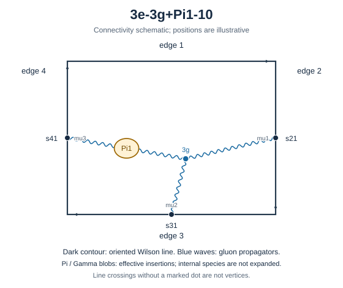

# 3e-3g+Pi1-10



Family: legs. Native Hlog arguments and the integral meaning of `rho` are retained. The scale logarithm L enters only after multiplying the sum by S3.

[Original source result](../../results/2026-10-23/sources/benchmarks/self-energy/tgv-pi1/results/3e-3g+Pi1-10/r003.json) · [Complete raw ledger](../../results/2026-10-23/diagram-ledger.json) · [Conventions](conventions.md)

## Native coefficients

The exact original field, zero provenance and raw syntax are recorded in `native_unweighted` in the ledger. The normalized expressions below do not apply a new r-to-z transformation.

### Native coefficient of $`\epsilon^{-6}`$

```math

0

```

### Native coefficient of $`\epsilon^{-5}`$

```math

0

```

### Native coefficient of $`\epsilon^{-4}`$

```math

\frac{1}{768}

```

### Native coefficient of $`\epsilon^{-3}`$

```math

\frac{1}{384} + \frac{\pi^{2}}{768}

```

### Native coefficient of $`\epsilon^{-2}`$

```math

\begin{aligned}& - \frac{3 \pi^{2} G(-1;z)}{256} - \frac{3 G(-1,0,0;z)}{128} + \frac{\rho^{3}}{512} + \frac{3 \pi^{2} \rho}{512} - \frac{7 \zeta\left(3\right)}{384} + \frac{1}{192}\\ & {} + \frac{7 \pi^{2}}{3072}\end{aligned}

```

### Native coefficient of $`\epsilon^{-1}`$

```math

\begin{aligned}& - \frac{19 \pi^{2} G(0,-1;z)}{512} - \frac{19 G(0,-1,0,0;z)}{256} - G(-1;z) \left(- \frac{19 \zeta\left(3\right)}{128} + \frac{3 \pi^{2}}{128}\right)\\ & {} - \frac{19 \pi^{2} G(-1,0;z)}{512} - \frac{3 G(-1,0,0;z)}{64} - \frac{19 G(-1,0,0,0;z)}{256} + \frac{19 \pi^{2} G(-1,-1;z)}{256} + \frac{19 G(-1,-1,0,0;z)}{128}\\ & {} + \frac{13 \rho^{4}}{6144} + \frac{\rho^{3}}{256} + \frac{23 \pi^{2} \rho^{2}}{3072} - \rho \left(- \frac{3 \pi^{2}}{256} + \frac{19 \zeta\left(3\right)}{256}\right)\\ & {} - \frac{11 \zeta\left(3\right)}{256} + \frac{7}{384} + \frac{11 \pi^{2}}{1536} + \frac{43 \pi^{4}}{6144}\end{aligned}

```

### Native coefficient of $`\epsilon^{0}`$

```math

\begin{aligned}& - \frac{17 \pi^{2} G(0,0,-1;z)}{256} - \frac{17 G(0,0,-1,0,0;z)}{128} - G(0,-1;z) \left(- \frac{81 \zeta\left(3\right)}{256} + \frac{19 \pi^{2}}{256}\right)\\ & {} - \frac{11 \pi^{2} G(0,-1,0;z)}{192} - \frac{19 G(0,-1,0,0;z)}{128} - \frac{7 G(0,-1,0,0,0;z)}{256} + \frac{81 \pi^{2} G(0,-1,-1;z)}{512}\\ & {} + \frac{81 G(0,-1,-1,0,0;z)}{256} - G(-1;z) \left(- \frac{19 \zeta\left(3\right)}{64} + \frac{3 \pi^{2}}{64} + \frac{683 \pi^{4}}{30720}\right)\\ & {} - G(-1,0;z) \left(- \frac{81 \zeta\left(3\right)}{256} + \frac{19 \pi^{2}}{256}\right) - G(-1,0,0;z) \left(\frac{3}{32} + \frac{41 \pi^{2}}{768}\right)\\ & {} - \frac{19 G(-1,0,0,0;z)}{128} + \frac{5 G(-1,0,0,0,0;z)}{256} + \frac{81 \pi^{2} G(-1,0,-1;z)}{512} + \frac{81 G(-1,0,-1,0,0;z)}{256}\\ & {} - G(-1,-1;z) \left(- \frac{19 \pi^{2}}{128} + \frac{81 \zeta\left(3\right)}{128}\right) + \frac{81 \pi^{2} G(-1,-1,0;z)}{512} + \frac{19 G(-1,-1,0,0;z)}{64}\\ & {} + \frac{81 G(-1,-1,0,0,0;z)}{256} - \frac{81 \pi^{2} G(-1,-1,-1;z)}{256} - \frac{81 G(-1,-1,-1,0,0;z)}{128} - \frac{3 \rho^{5}}{4096} + \frac{13 \rho^{4}}{3072}\\ & {} - \frac{\rho^{3} \left(- \frac{29 \pi^{2}}{3072} - \frac{3}{64}\right)}{6}\\ & {} - \frac{\rho^{2} \left(- \frac{23 \pi^{2}}{768} + \frac{47 \zeta\left(3\right)}{256}\right)}{2}\\ & {} - \rho \left(- \frac{2287 \pi^{4}}{184320} - \frac{3 \pi^{2}}{128} + \frac{19 \zeta\left(3\right)}{128}\right) - \frac{49 \pi^{2} \zeta\left(3\right)}{384}\\ & {} - \frac{521 \zeta\left(5\right)}{768} - \frac{7 \zeta\left(3\right)}{128} + \frac{7}{192} + \frac{\pi^{2}}{128} + \frac{1657 \pi^{4}}{122880}\end{aligned}

```

## Af color-weighted contribution

Each coefficient is after the declared external multiplier/convolution and before S3.

### Weighted coefficient of $`\epsilon^{-6}`$

```math

0

```

### Weighted coefficient of $`\epsilon^{-5}`$

```math

0

```

### Weighted coefficient of $`\epsilon^{-4}`$

```math

- \frac{1}{288}

```

### Weighted coefficient of $`\epsilon^{-3}`$

```math

- \frac{\pi^{2}}{288} - \frac{5}{864}

```

### Weighted coefficient of $`\epsilon^{-2}`$

```math

\begin{aligned}& \frac{\pi^{2} G(-1;z)}{32} + \frac{G(-1,0,0;z)}{16} - \frac{\rho^{3}}{192} - \frac{\pi^{2} \rho}{64} - \frac{17 \pi^{2}}{3456} - \frac{7}{648}\\ & {} + \frac{7 \zeta\left(3\right)}{144}\end{aligned}

```

### Weighted coefficient of $`\epsilon^{-1}`$

```math

\begin{aligned}& \frac{19 \pi^{2} G(0,-1;z)}{192} + \frac{19 G(0,-1,0,0;z)}{96} - \frac{19 G(-1;z) \zeta\left(3\right)}{48} + \frac{5 \pi^{2} G(-1;z)}{96}\\ & {} + \frac{19 \pi^{2} G(-1,0;z)}{192} + \frac{5 G(-1,0,0;z)}{48} + \frac{19 G(-1,0,0,0;z)}{96} - \frac{19 \pi^{2} G(-1,-1;z)}{96} - \frac{19 G(-1,-1,0,0;z)}{48}\\ & {} - \frac{13 \rho^{4}}{2304} - \frac{5 \rho^{3}}{576} - \frac{23 \pi^{2} \rho^{2}}{1152} - \frac{5 \pi^{2} \rho}{192} + \frac{19 \rho \zeta\left(3\right)}{96}\\ & {} - \frac{43 \pi^{4}}{2304} - \frac{169 \pi^{2}}{10368} - \frac{163}{3888} + \frac{85 \zeta\left(3\right)}{864}\end{aligned}

```

### Weighted coefficient of $`\epsilon^{0}`$

```math

\begin{aligned}& \frac{17 \pi^{2} G(0,0,-1;z)}{96} + \frac{17 G(0,0,-1,0,0;z)}{48} - \frac{27 G(0,-1;z) \zeta\left(3\right)}{32} + \frac{95 \pi^{2} G(0,-1;z)}{576}\\ & {} + \frac{11 \pi^{2} G(0,-1,0;z)}{72} + \frac{95 G(0,-1,0,0;z)}{288} + \frac{7 G(0,-1,0,0,0;z)}{96} - \frac{27 \pi^{2} G(0,-1,-1;z)}{64} - \frac{27 G(0,-1,-1,0,0;z)}{32}\\ & {} - \frac{95 G(-1;z) \zeta\left(3\right)}{144} + \frac{7 \pi^{2} G(-1;z)}{72} + \frac{683 \pi^{4} G(-1;z)}{11520} - \frac{27 G(-1,0;z) \zeta\left(3\right)}{32}\\ & {} + \frac{95 \pi^{2} G(-1,0;z)}{576} + \frac{7 G(-1,0,0;z)}{36} + \frac{41 \pi^{2} G(-1,0,0;z)}{288} + \frac{95 G(-1,0,0,0;z)}{288} - \frac{5 G(-1,0,0,0,0;z)}{96}\\ & {} - \frac{27 \pi^{2} G(-1,0,-1;z)}{64} - \frac{27 G(-1,0,-1,0,0;z)}{32} - \frac{95 \pi^{2} G(-1,-1;z)}{288} + \frac{27 G(-1,-1;z) \zeta\left(3\right)}{16}\\ & {} - \frac{27 \pi^{2} G(-1,-1,0;z)}{64} - \frac{95 G(-1,-1,0,0;z)}{144} - \frac{27 G(-1,-1,0,0,0;z)}{32} + \frac{27 \pi^{2} G(-1,-1,-1;z)}{32}\\ & {} + \frac{27 G(-1,-1,-1,0,0;z)}{16} + \frac{\rho^{5}}{512} - \frac{65 \rho^{4}}{6912} - \frac{29 \pi^{2} \rho^{3}}{6912} - \frac{7 \rho^{3}}{432}\\ & {} - \frac{115 \pi^{2} \rho^{2}}{3456} + \frac{47 \rho^{2} \zeta\left(3\right)}{192} - \frac{2287 \pi^{4} \rho}{69120} - \frac{7 \pi^{2} \rho}{144}\\ & {} + \frac{95 \rho \zeta\left(3\right)}{288} - \frac{4111 \pi^{4}}{138240} - \frac{49 \pi^{2}}{3888} - \frac{893}{11664} + \frac{251 \zeta\left(3\right)}{2592}\\ & {} + \frac{521 \zeta\left(5\right)}{288} + \frac{49 \pi^{2} \zeta\left(3\right)}{144}\end{aligned}

```

