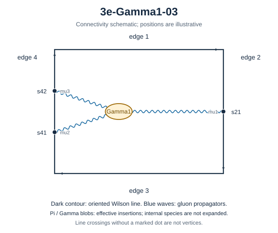

# 3e-Gamma1-03



Family: Gamma. Native Hlog arguments and the integral meaning of `rho` are retained. The scale logarithm L enters only after multiplying the sum by S3.

[Original source result](../../results/2026-10-23/sources/benchmarks/self-energy/gamma1/results/3e-Gamma1-03/z-r003.json) · [Complete raw ledger](../../results/2026-10-23/diagram-ledger.json) · [Conventions](conventions.md)

## Native coefficients

The exact original field, zero provenance and raw syntax are recorded in `native_unweighted` in the ledger. The normalized expressions below do not apply a new r-to-z transformation.

### Native coefficient of $`\epsilon^{-6}`$

```math

0

```

### Native coefficient of $`\epsilon^{-5}`$

```math

0

```

### Native coefficient of $`\epsilon^{-4}`$

```math

0

```

### Native coefficient of $`\epsilon^{-3}`$

```math

0

```

### Native coefficient of $`\epsilon^{-2}`$

```math

\begin{aligned}& - \frac{\pi^{2} G(-1;z)}{48} - \frac{G(-1,0,0;z)}{24} + \frac{\rho^{3}}{288} + \frac{\rho^{2}}{48} + \frac{\pi^{2} \rho}{96} - \frac{\zeta\left(3\right)}{24}\\ & {} + \frac{\pi^{2}}{54}\end{aligned}

```

### Native coefficient of $`\epsilon^{-1}`$

```math

\begin{aligned}& - \frac{\pi^{2} G(0,-1;z)}{32} - \frac{G(0,-1,0,0;z)}{16} - G(-1;z) \left(- \frac{\zeta\left(3\right)}{8} + \frac{25 \pi^{2}}{288}\right) - \frac{\pi^{2} G(-1,0;z)}{32}\\ & {} - \frac{25 G(-1,0,0;z)}{144} - \frac{G(-1,0,0,0;z)}{16} + \frac{\pi^{2} G(-1,-1;z)}{16} + \frac{G(-1,-1,0,0;z)}{8} + \frac{\rho^{4}}{576}\\ & {} + \frac{\rho^{3} \left(\frac{11 z}{144} + \frac{7}{72}\right)}{6 z + 6} - \frac{\rho^{2} \left(- \frac{53}{288} - \frac{\pi^{2}}{144}\right)}{2}\\ & {} + \frac{\rho \left(- \frac{z \zeta\left(3\right)}{16} + \frac{\pi^{2} z}{24} - \frac{\zeta\left(3\right)}{16} + \frac{13 \pi^{2}}{288}\right)}{z + 1}\\ & {} - \frac{\zeta\left(3\right)}{16} - \frac{1}{72} + \frac{\pi^{4}}{1440} + \frac{445 \pi^{2}}{5184}\end{aligned}

```

### Native coefficient of $`\epsilon^{0}`$

```math

\begin{aligned}& \frac{\pi^{2} G(0,0,-1;z)}{24} + \frac{G(0,0,-1,0,0;z)}{12} - G(0,-1;z) \left(- \frac{3 \zeta\left(3\right)}{16} + \frac{25 \pi^{2}}{192}\right)\\ & {} - \frac{\pi^{2} G(0,-1,0;z)}{72} - \frac{25 G(0,-1,0,0;z)}{96} + \frac{5 G(0,-1,0,0,0;z)}{48} + \frac{3 \pi^{2} G(0,-1,-1;z)}{32} + \frac{3 G(0,-1,-1,0,0;z)}{16}\\ & {} - G(-1;z) \left(- \frac{25 \zeta\left(3\right)}{48} + \frac{7 \pi^{4}}{360} + \frac{577 \pi^{2}}{1728}\right)\\ & {} - G(-1,0;z) \left(- \frac{3 \zeta\left(3\right)}{16} + \frac{25 \pi^{2}}{192}\right) - G(-1,0,0;z) \left(\frac{5 \pi^{2}}{288} + \frac{577}{864}\right)\\ & {} - \frac{25 G(-1,0,0,0;z)}{96} + \frac{G(-1,0,0,0,0;z)}{3} + \frac{3 \pi^{2} G(-1,0,-1;z)}{32} + \frac{3 G(-1,0,-1,0,0;z)}{16}\\ & {} - G(-1,-1;z) \left(- \frac{25 \pi^{2}}{96} + \frac{3 \zeta\left(3\right)}{8}\right) + \frac{3 \pi^{2} G(-1,-1,0;z)}{32} + \frac{25 G(-1,-1,0,0;z)}{48}\\ & {} + \frac{3 G(-1,-1,0,0,0;z)}{16} - \frac{3 \pi^{2} G(-1,-1,-1;z)}{16} - \frac{3 G(-1,-1,-1,0,0;z)}{8} - \frac{17 \rho^{5}}{5760} - \frac{11 \rho^{4}}{864}\\ & {} - \frac{\rho^{3} \left(- \frac{565 z}{1728} + \frac{5 \pi^{2} z}{96} - \frac{589}{1728} + \frac{5 \pi^{2}}{96}\right)}{6 z + 6}\\ & {} - \frac{\rho^{2} \left(- \frac{1193}{1728} - \frac{19 \pi^{2}}{864} + \frac{3 \zeta\left(3\right)}{8}\right)}{2}\\ & {} + \frac{\rho \left(- \frac{25 z \zeta\left(3\right)}{96} + \frac{\pi^{4} z}{540} + \frac{191 \pi^{2} z}{1152} - \frac{25 \zeta\left(3\right)}{96} + \frac{\pi^{4}}{540} + \frac{581 \pi^{2}}{3456}\right)}{z + 1}\\ & {} - \frac{23 \pi^{2} \zeta\left(3\right)}{96} - \frac{283 \zeta\left(3\right)}{288} - \frac{1}{16} + \frac{5 \zeta\left(5\right)}{12} + \frac{323 \pi^{4}}{17280}\\ & {} + \frac{10609 \pi^{2}}{31104}\end{aligned}

```

## Af color-weighted contribution

Each coefficient is after the declared external multiplier/convolution and before S3.

### Weighted coefficient of $`\epsilon^{-6}`$

```math

0

```

### Weighted coefficient of $`\epsilon^{-5}`$

```math

0

```

### Weighted coefficient of $`\epsilon^{-4}`$

```math

0

```

### Weighted coefficient of $`\epsilon^{-3}`$

```math

0

```

### Weighted coefficient of $`\epsilon^{-2}`$

```math

\begin{aligned}& - \frac{\pi^{2} G(-1;z)}{48} - \frac{G(-1,0,0;z)}{24} + \frac{\rho^{3}}{288} + \frac{\rho^{2}}{48} + \frac{\pi^{2} \rho}{96} - \frac{\zeta\left(3\right)}{24}\\ & {} + \frac{\pi^{2}}{54}\end{aligned}

```

### Weighted coefficient of $`\epsilon^{-1}`$

```math

\begin{aligned}& - \frac{\pi^{2} G(0,-1;z)}{32} - \frac{G(0,-1,0,0;z)}{16} - G(-1;z) \left(- \frac{\zeta\left(3\right)}{8} + \frac{25 \pi^{2}}{288}\right) - \frac{\pi^{2} G(-1,0;z)}{32}\\ & {} - \frac{25 G(-1,0,0;z)}{144} - \frac{G(-1,0,0,0;z)}{16} + \frac{\pi^{2} G(-1,-1;z)}{16} + \frac{G(-1,-1,0,0;z)}{8} + \frac{\rho^{4}}{576}\\ & {} + \frac{\rho^{3} \left(\frac{11 z}{144} + \frac{7}{72}\right)}{6 z + 6} - \frac{\rho^{2} \left(- \frac{53}{288} - \frac{\pi^{2}}{144}\right)}{2}\\ & {} + \frac{\rho \left(- \frac{z \zeta\left(3\right)}{16} + \frac{\pi^{2} z}{24} - \frac{\zeta\left(3\right)}{16} + \frac{13 \pi^{2}}{288}\right)}{z + 1}\\ & {} - \frac{\zeta\left(3\right)}{16} - \frac{1}{72} + \frac{\pi^{4}}{1440} + \frac{445 \pi^{2}}{5184}\end{aligned}

```

### Weighted coefficient of $`\epsilon^{0}`$

```math

\begin{aligned}& \frac{\pi^{2} G(0,0,-1;z)}{24} + \frac{G(0,0,-1,0,0;z)}{12} - G(0,-1;z) \left(- \frac{3 \zeta\left(3\right)}{16} + \frac{25 \pi^{2}}{192}\right)\\ & {} - \frac{\pi^{2} G(0,-1,0;z)}{72} - \frac{25 G(0,-1,0,0;z)}{96} + \frac{5 G(0,-1,0,0,0;z)}{48} + \frac{3 \pi^{2} G(0,-1,-1;z)}{32} + \frac{3 G(0,-1,-1,0,0;z)}{16}\\ & {} - G(-1;z) \left(- \frac{25 \zeta\left(3\right)}{48} + \frac{7 \pi^{4}}{360} + \frac{577 \pi^{2}}{1728}\right)\\ & {} - G(-1,0;z) \left(- \frac{3 \zeta\left(3\right)}{16} + \frac{25 \pi^{2}}{192}\right) - G(-1,0,0;z) \left(\frac{5 \pi^{2}}{288} + \frac{577}{864}\right)\\ & {} - \frac{25 G(-1,0,0,0;z)}{96} + \frac{G(-1,0,0,0,0;z)}{3} + \frac{3 \pi^{2} G(-1,0,-1;z)}{32} + \frac{3 G(-1,0,-1,0,0;z)}{16}\\ & {} - G(-1,-1;z) \left(- \frac{25 \pi^{2}}{96} + \frac{3 \zeta\left(3\right)}{8}\right) + \frac{3 \pi^{2} G(-1,-1,0;z)}{32} + \frac{25 G(-1,-1,0,0;z)}{48}\\ & {} + \frac{3 G(-1,-1,0,0,0;z)}{16} - \frac{3 \pi^{2} G(-1,-1,-1;z)}{16} - \frac{3 G(-1,-1,-1,0,0;z)}{8} - \frac{17 \rho^{5}}{5760} - \frac{11 \rho^{4}}{864}\\ & {} - \frac{\rho^{3} \left(- \frac{565 z}{1728} + \frac{5 \pi^{2} z}{96} - \frac{589}{1728} + \frac{5 \pi^{2}}{96}\right)}{6 z + 6}\\ & {} - \frac{\rho^{2} \left(- \frac{1193}{1728} - \frac{19 \pi^{2}}{864} + \frac{3 \zeta\left(3\right)}{8}\right)}{2}\\ & {} + \frac{\rho \left(- \frac{25 z \zeta\left(3\right)}{96} + \frac{\pi^{4} z}{540} + \frac{191 \pi^{2} z}{1152} - \frac{25 \zeta\left(3\right)}{96} + \frac{\pi^{4}}{540} + \frac{581 \pi^{2}}{3456}\right)}{z + 1}\\ & {} - \frac{23 \pi^{2} \zeta\left(3\right)}{96} - \frac{283 \zeta\left(3\right)}{288} - \frac{1}{16} + \frac{5 \zeta\left(5\right)}{12} + \frac{323 \pi^{4}}{17280}\\ & {} + \frac{10609 \pi^{2}}{31104}\end{aligned}

```

