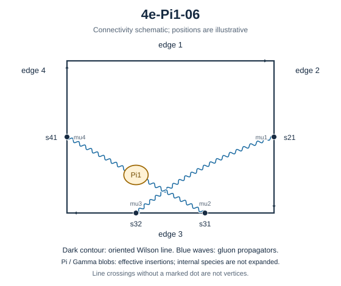

# 4e-Pi1-06



Family: Pi1. Native Hlog arguments and the integral meaning of `rho` are retained. The scale logarithm L enters only after multiplying the sum by S3.

[Original source result](../../results/2026-10-23/sources/benchmarks/self-energy/pi1/results/4e-Pi1-06/r002.json) · [Complete raw ledger](../../results/2026-10-23/diagram-ledger.json) · [Conventions](conventions.md)

## Native coefficients

The exact original field, zero provenance and raw syntax are recorded in `native_unweighted` in the ledger. The normalized expressions below do not apply a new r-to-z transformation.

### Native coefficient of $`\epsilon^{-6}`$

```math

0

```

### Native coefficient of $`\epsilon^{-5}`$

```math

0

```

### Native coefficient of $`\epsilon^{-4}`$

```math

0

```

### Native coefficient of $`\epsilon^{-3}`$

```math

- \frac{\pi^{2}}{384}

```

### Native coefficient of $`\epsilon^{-2}`$

```math

- \frac{\pi^{2}}{384} + \frac{3 \zeta\left(3\right)}{64}

```

### Native coefficient of $`\epsilon^{-1}`$

```math

\frac{\pi^{2} \rho^{2}}{384} - \frac{37 \pi^{4}}{23040} - \frac{\pi^{2}}{128} + \frac{3 \zeta\left(3\right)}{64}

```

### Native coefficient of $`\epsilon^{0}`$

```math

\begin{aligned}& - \frac{3 \rho^{2} \zeta\left(3\right)}{64} + \frac{\pi^{2} \rho^{2}}{384} - \frac{37 \pi^{4}}{23040} - \frac{5 \pi^{2}}{384} - \frac{5 \pi^{2} \zeta\left(3\right)}{768}\\ & {} + \frac{9 \zeta\left(3\right)}{64} + \frac{21 \zeta\left(5\right)}{64}\end{aligned}

```

## Af color-weighted contribution

Each coefficient is after the declared external multiplier/convolution and before S3.

### Weighted coefficient of $`\epsilon^{-6}`$

```math

0

```

### Weighted coefficient of $`\epsilon^{-5}`$

```math

0

```

### Weighted coefficient of $`\epsilon^{-4}`$

```math

0

```

### Weighted coefficient of $`\epsilon^{-3}`$

```math

\frac{\pi^{2}}{144}

```

### Weighted coefficient of $`\epsilon^{-2}`$

```math

- \frac{\zeta\left(3\right)}{8} + \frac{\pi^{2}}{216}

```

### Weighted coefficient of $`\epsilon^{-1}`$

```math

- \frac{\pi^{2} \rho^{2}}{144} - \frac{\zeta\left(3\right)}{12} + \frac{11 \pi^{2}}{648} + \frac{37 \pi^{4}}{8640}

```

### Weighted coefficient of $`\epsilon^{0}`$

```math

\begin{aligned}& - \frac{\pi^{2} \rho^{2}}{216} + \frac{\rho^{2} \zeta\left(3\right)}{8} - \frac{7 \zeta\left(5\right)}{8} - \frac{11 \zeta\left(3\right)}{36}\\ & {} + \frac{5 \pi^{2} \zeta\left(3\right)}{288} + \frac{49 \pi^{2}}{1944} + \frac{37 \pi^{4}}{12960}\end{aligned}

```

