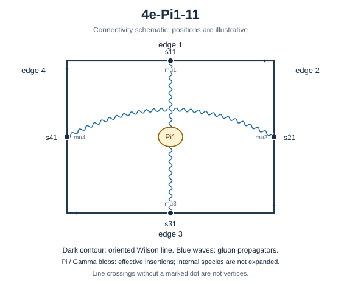

# 4e-Pi1-11



Family: Pi1. Native Hlog arguments and the integral meaning of `rho` are retained. The scale logarithm L enters only after multiplying the sum by S3.

[Original source result](../../results/2026-10-23/sources/benchmarks/self-energy/pi1/results/4e-Pi1-11/r002.json) · [Complete raw ledger](../../results/2026-10-23/diagram-ledger.json) · [Conventions](conventions.md)

## Native coefficients

The exact original field, zero provenance and raw syntax are recorded in `native_unweighted` in the ledger. The normalized expressions below do not apply a new r-to-z transformation.

### Native coefficient of $`\epsilon^{-6}`$

```math

0

```

### Native coefficient of $`\epsilon^{-5}`$

```math

0

```

### Native coefficient of $`\epsilon^{-4}`$

```math

0

```

### Native coefficient of $`\epsilon^{-3}`$

```math

0

```

### Native coefficient of $`\epsilon^{-2}`$

```math

\frac{\rho^{2}}{256} + \frac{\pi^{2}}{256}

```

### Native coefficient of $`\epsilon^{-1}`$

```math

\begin{aligned}& - \frac{\pi^{2} G(-1;z)}{256} - \frac{G(-1,0,0;z)}{128} - \frac{\rho^{4}}{256} + \frac{\rho^{3}}{1536} - \frac{\pi^{2} \rho^{2}}{128} + \frac{\rho^{2}}{256}\\ & {} + \frac{\pi^{2} \rho}{512} - \frac{\pi^{4}}{256} - \frac{\zeta\left(3\right)}{128} + \frac{\pi^{2}}{256}\end{aligned}

```

### Native coefficient of $`\epsilon^{0}`$

```math

\begin{aligned}& \frac{3 \pi^{2} G(0,0,-1;z)}{128} + \frac{3 G(0,0,-1,0,0;z)}{64} - \frac{\pi^{2} G(0,-1;z)}{512} + \frac{3 \pi^{2} G(0,-1,0;z)}{128} - \frac{G(0,-1,0,0;z)}{256}\\ & {} + \frac{9 G(0,-1,0,0,0;z)}{64} - \frac{\pi^{2} G(-1;z)}{256} + \frac{G(-1;z) \zeta\left(3\right)}{128} + \frac{3 \pi^{4} G(-1;z)}{256} - \frac{\pi^{2} G(-1,0;z)}{512}\\ & {} - \frac{G(-1,0,0;z)}{128} + \frac{3 \pi^{2} G(-1,0,0;z)}{64} - \frac{G(-1,0,0,0;z)}{256} + \frac{9 G(-1,0,0,0,0;z)}{32} + \frac{\pi^{2} G(-1,-1;z)}{256}\\ & {} + \frac{G(-1,-1,0,0;z)}{128} - \frac{\rho^{5}}{512} - \frac{31 \rho^{4}}{3072} - \frac{\pi^{2} \rho^{3}}{128} + \frac{\rho^{3}}{1536} - \frac{17 \pi^{2} \rho^{2}}{1024}\\ & {} + \frac{3 \rho^{2}}{256} + \frac{3 \rho^{2} \zeta\left(3\right)}{128} - \frac{3 \pi^{4} \rho}{512} - \frac{\rho \zeta\left(3\right)}{256} + \frac{\pi^{2} \rho}{512}\\ & {} - \frac{101 \pi^{4}}{15360} - \frac{\zeta\left(3\right)}{128} + \frac{3 \pi^{2}}{256} + \frac{3 \pi^{2} \zeta\left(3\right)}{128}\end{aligned}

```

## Af color-weighted contribution

Each coefficient is after the declared external multiplier/convolution and before S3.

### Weighted coefficient of $`\epsilon^{-6}`$

```math

0

```

### Weighted coefficient of $`\epsilon^{-5}`$

```math

0

```

### Weighted coefficient of $`\epsilon^{-4}`$

```math

0

```

### Weighted coefficient of $`\epsilon^{-3}`$

```math

0

```

### Weighted coefficient of $`\epsilon^{-2}`$

```math

- \frac{\rho^{2}}{96} - \frac{\pi^{2}}{96}

```

### Weighted coefficient of $`\epsilon^{-1}`$

```math

\begin{aligned}& \frac{\pi^{2} G(-1;z)}{96} + \frac{G(-1,0,0;z)}{48} + \frac{\rho^{4}}{96} - \frac{\rho^{3}}{576} - \frac{\rho^{2}}{144} + \frac{\pi^{2} \rho^{2}}{48}\\ & {} - \frac{\pi^{2} \rho}{192} - \frac{\pi^{2}}{144} + \frac{\zeta\left(3\right)}{48} + \frac{\pi^{4}}{96}\end{aligned}

```

### Weighted coefficient of $`\epsilon^{0}`$

```math

\begin{aligned}& - \frac{\pi^{2} G(0,0,-1;z)}{16} - \frac{G(0,0,-1,0,0;z)}{8} + \frac{\pi^{2} G(0,-1;z)}{192} - \frac{\pi^{2} G(0,-1,0;z)}{16} + \frac{G(0,-1,0,0;z)}{96}\\ & {} - \frac{3 G(0,-1,0,0,0;z)}{8} - \frac{\pi^{4} G(-1;z)}{32} - \frac{G(-1;z) \zeta\left(3\right)}{48} + \frac{\pi^{2} G(-1;z)}{144} + \frac{\pi^{2} G(-1,0;z)}{192}\\ & {} - \frac{\pi^{2} G(-1,0,0;z)}{8} + \frac{G(-1,0,0;z)}{72} + \frac{G(-1,0,0,0;z)}{96} - \frac{3 G(-1,0,0,0,0;z)}{4} - \frac{\pi^{2} G(-1,-1;z)}{96}\\ & {} - \frac{G(-1,-1,0,0;z)}{48} + \frac{\rho^{5}}{192} + \frac{3 \rho^{4}}{128} - \frac{\rho^{3}}{864} + \frac{\pi^{2} \rho^{3}}{48}\\ & {} - \frac{\rho^{2} \zeta\left(3\right)}{16} - \frac{11 \rho^{2}}{432} + \frac{43 \pi^{2} \rho^{2}}{1152} - \frac{\pi^{2} \rho}{288} + \frac{\rho \zeta\left(3\right)}{96}\\ & {} + \frac{\pi^{4} \rho}{64} - \frac{\pi^{2} \zeta\left(3\right)}{16} - \frac{11 \pi^{2}}{432} + \frac{\zeta\left(3\right)}{72} + \frac{9 \pi^{4}}{640}\end{aligned}

```

