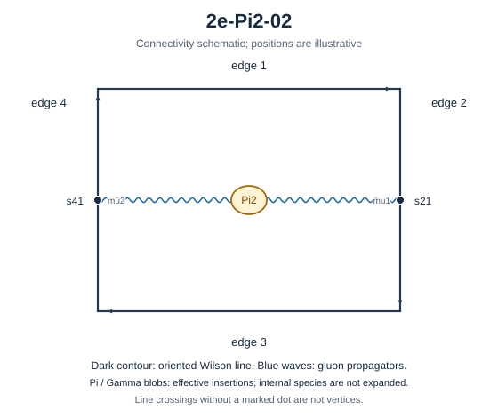

# 2e-Pi2-02

Family: Pi2. Native Hlog arguments and the integral meaning of `rho` are retained. The scale logarithm L enters only after multiplying the sum by S3.

[Original source result](sources/benchmarks/self-energy/pi2/results/2e-Pi2-02/r002.json) · [Complete raw ledger](diagram-ledger.json) · [Conventions](conventions.md)

## Native coefficients

The exact original field, zero provenance and raw syntax are recorded in `native_unweighted` in the ledger. The normalized expressions below do not apply a new r-to-z transformation.

### Native coefficient of $\epsilon^{-6}$

\[
0
\]
### Native coefficient of $\epsilon^{-5}$

\[
0
\]
### Native coefficient of $\epsilon^{-4}$

\[
0
\]
### Native coefficient of $\epsilon^{-3}$

\[
\frac{1}{384}
\]
### Native coefficient of $\epsilon^{-2}$

\[
- \frac{\rho^{2}}{256} - \frac{\pi^{2}}{256} + \frac{1}{192}
\]
### Native coefficient of $\epsilon^{-1}$

\[
\begin{aligned}& \frac{3 \pi^{2} G(-1;z)}{256} + \frac{3 G(-1,0,0;z)}{128} - \frac{\rho^{3}}{512} - \frac{\rho^{2}}{64} - \frac{3 \pi^{2} \rho}{512} - \frac{23 \pi^{2}}{1536}\\ & {} + \frac{1}{48} + \frac{3 \zeta\left(3\right)}{128}\end{aligned}
\]
### Native coefficient of $\epsilon^{0}$

\[
\begin{aligned}& \frac{9 \pi^{2} G(0,-1;z)}{512} + \frac{9 G(0,-1,0,0;z)}{256} - \frac{9 G(-1;z) \zeta\left(3\right)}{128} + \frac{3 \pi^{2} G(-1;z)}{64} + \frac{9 \pi^{2} G(-1,0;z)}{512}\\ & {} + \frac{3 G(-1,0,0;z)}{32} + \frac{9 G(-1,0,0,0;z)}{256} - \frac{9 \pi^{2} G(-1,-1;z)}{256} - \frac{9 G(-1,-1,0,0;z)}{128} + \frac{3 \rho^{4}}{1024}\\ & {} - \frac{\rho^{3}}{128} - \frac{3 \rho^{2}}{64} - \frac{\pi^{2} \rho^{2}}{1024} - \frac{3 \pi^{2} \rho}{128} + \frac{9 \rho \zeta\left(3\right)}{256}\\ & {} - \frac{35 \pi^{2}}{768} - \frac{17 \pi^{4}}{5120} + \frac{1}{24} + \frac{43 \zeta\left(3\right)}{384}\end{aligned}
\]
## Af color-weighted contribution

Each coefficient is after the declared external multiplier/convolution and before S3.

### Weighted coefficient of $\epsilon^{-6}$

\[
0
\]
### Weighted coefficient of $\epsilon^{-5}$

\[
0
\]
### Weighted coefficient of $\epsilon^{-4}$

\[
0
\]
### Weighted coefficient of $\epsilon^{-3}$

\[
\frac{5}{288}
\]
### Weighted coefficient of $\epsilon^{-2}$

\[
- \frac{5 \rho^{2}}{192} - \frac{5 \pi^{2}}{192} + \frac{41}{1728}
\]
### Weighted coefficient of $\epsilon^{-1}$

\[
\begin{aligned}& \frac{5 \pi^{2} G(-1;z)}{64} + \frac{5 G(-1,0,0;z)}{32} - \frac{5 \rho^{3}}{384} - \frac{101 \rho^{2}}{1152} - \frac{5 \pi^{2} \rho}{128} - \frac{\pi^{2}}{12}\\ & {} + \frac{1469}{10368} + \frac{23 \zeta\left(3\right)}{96}\end{aligned}
\]
### Weighted coefficient of $\epsilon^{0}$

\[
\begin{aligned}& \frac{15 \pi^{2} G(0,-1;z)}{128} + \frac{15 G(0,-1,0,0;z)}{64} - \frac{15 G(-1;z) \zeta\left(3\right)}{32} + \frac{101 \pi^{2} G(-1;z)}{384}\\ & {} + \frac{15 \pi^{2} G(-1,0;z)}{128} + \frac{101 G(-1,0,0;z)}{192} + \frac{15 G(-1,0,0,0;z)}{64} - \frac{15 \pi^{2} G(-1,-1;z)}{64} - \frac{15 G(-1,-1,0,0;z)}{32}\\ & {} + \frac{5 \rho^{4}}{256} - \frac{101 \rho^{3}}{2304} - \frac{1961 \rho^{2}}{6912} - \frac{\rho^{2} \zeta\left(3\right)}{8} - \frac{5 \pi^{2} \rho^{2}}{768}\\ & {} - \frac{101 \pi^{2} \rho}{768} + \frac{15 \rho \zeta\left(3\right)}{64} - \frac{5 \pi^{2}}{18} - \frac{239 \pi^{4}}{11520} - \frac{\pi^{2} \zeta\left(3\right)}{8}\\ & {} + \frac{14597}{62208} + \frac{107 \zeta\left(3\right)}{192}\end{aligned}
\]
## Ff color-weighted contribution

Each coefficient is after the declared external multiplier/convolution and before S3.

### Weighted coefficient of $\epsilon^{-6}$

\[
0
\]
### Weighted coefficient of $\epsilon^{-5}$

\[
0
\]
### Weighted coefficient of $\epsilon^{-4}$

\[
0
\]
### Weighted coefficient of $\epsilon^{-3}$

\[
0
\]
### Weighted coefficient of $\epsilon^{-2}$

\[
\frac{1}{48}
\]
### Weighted coefficient of $\epsilon^{-1}$

\[
- \frac{\rho^{2}}{32} - \frac{\pi^{2}}{32} - \frac{\zeta\left(3\right)}{6} + \frac{43}{288}
\]
### Weighted coefficient of $\epsilon^{0}$

\[
\begin{aligned}& \frac{3 \pi^{2} G(-1;z)}{32} + \frac{3 G(-1,0,0;z)}{16} - \frac{\rho^{3}}{64} - \frac{55 \rho^{2}}{192} + \frac{\rho^{2} \zeta\left(3\right)}{4}\\ & {} - \frac{3 \pi^{2} \rho}{64} - \frac{9 \pi^{2}}{32} - \frac{\pi^{4}}{360} - \frac{\zeta\left(3\right)}{144} + \frac{1195}{1728} + \frac{\pi^{2} \zeta\left(3\right)}{4}\end{aligned}
\]
