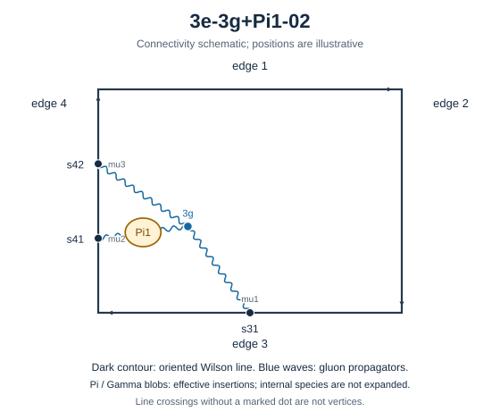

# 3e-3g+Pi1-02

Family: legs. Native Hlog arguments and the integral meaning of `rho` are retained. The scale logarithm L enters only after multiplying the sum by S3.

[Original source result](sources/benchmarks/self-energy/tgv-pi1/results/3e-3g+Pi1-02/r003.json) · [Complete raw ledger](diagram-ledger.json) · [Conventions](conventions.md)

## Native coefficients

The exact original field, zero provenance and raw syntax are recorded in `native_unweighted` in the ledger. The normalized expressions below do not apply a new r-to-z transformation.

### Native coefficient of $\epsilon^{-6}$

\[
0
\]
### Native coefficient of $\epsilon^{-5}$

\[
\frac{1}{2304}
\]
### Native coefficient of $\epsilon^{-4}$

\[
- \frac{1}{4608}
\]
### Native coefficient of $\epsilon^{-3}$

\[
- \frac{65}{9216} + \frac{\pi^{2}}{1024}
\]
### Native coefficient of $\epsilon^{-2}$

\[
- \frac{55}{2048} + \frac{13 \zeta\left(3\right)}{2304} + \frac{31 \pi^{2}}{18432}
\]
### Native coefficient of $\epsilon^{-1}$

\[
- \frac{3925}{36864} + \frac{47 \zeta\left(3\right)}{4608} + \frac{7 \pi^{2}}{4096} + \frac{199 \pi^{4}}{221184}
\]
### Native coefficient of $\epsilon^{0}$

\[
\begin{aligned}& - \frac{25199}{73728} + \frac{17 \pi^{2}}{73728} + \frac{127 \zeta\left(3\right)}{9216} + \frac{47 \zeta\left(5\right)}{1280}\\ & {} + \frac{23 \pi^{2} \zeta\left(3\right)}{3072} + \frac{259 \pi^{4}}{147456}\end{aligned}
\]
## Af color-weighted contribution

Each coefficient is after the declared external multiplier/convolution and before S3.

### Weighted coefficient of $\epsilon^{-6}$

\[
0
\]
### Weighted coefficient of $\epsilon^{-5}$

\[
- \frac{1}{864}
\]
### Weighted coefficient of $\epsilon^{-4}$

\[
\frac{5}{5184}
\]
### Weighted coefficient of $\epsilon^{-3}$

\[
\frac{587}{31104} - \frac{\pi^{2}}{384}
\]
### Weighted coefficient of $\epsilon^{-2}$

\[
- \frac{25 \pi^{2}}{6912} - \frac{13 \zeta\left(3\right)}{864} + \frac{12203}{186624}
\]
### Weighted coefficient of $\epsilon^{-1}$

\[
- \frac{199 \pi^{4}}{82944} - \frac{115 \zeta\left(3\right)}{5184} - \frac{103 \pi^{2}}{41472} + \frac{286547}{1119744}
\]
### Weighted coefficient of $\epsilon^{0}$

\[
\begin{aligned}& - \frac{1933 \pi^{4}}{497664} - \frac{23 \pi^{2} \zeta\left(3\right)}{1152} - \frac{47 \zeta\left(5\right)}{480} - \frac{757 \zeta\left(3\right)}{31104}\\ & {} + \frac{569 \pi^{2}}{248832} + \frac{5361995}{6718464}\end{aligned}
\]
