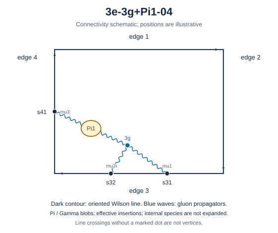

# 3e-3g+Pi1-04

Family: legs. Native Hlog arguments and the integral meaning of `rho` are retained. The scale logarithm L enters only after multiplying the sum by S3.

[Original source result](sources/benchmarks/self-energy/tgv-pi1/results/3e-3g+Pi1-04/r003.json) · [Complete raw ledger](diagram-ledger.json) · [Conventions](conventions.md)

## Native coefficients

The exact original field, zero provenance and raw syntax are recorded in `native_unweighted` in the ledger. The normalized expressions below do not apply a new r-to-z transformation.

### Native coefficient of $\epsilon^{-6}$

\[
0
\]
### Native coefficient of $\epsilon^{-5}$

\[
\frac{1}{1152}
\]
### Native coefficient of $\epsilon^{-4}$

\[
- \frac{7}{2304}
\]
### Native coefficient of $\epsilon^{-3}$

\[
- \frac{1}{192} + \frac{7 \pi^{2}}{4608}
\]
### Native coefficient of $\epsilon^{-2}$

\[
- \frac{17}{576} - \frac{\pi^{2}}{9216} + \frac{7 \zeta\left(3\right)}{1152}
\]
### Native coefficient of $\epsilon^{-1}$

\[
- \frac{1}{18} - \frac{49 \zeta\left(3\right)}{2304} + \frac{\pi^{2}}{256} + \frac{547 \pi^{4}}{552960}
\]
### Native coefficient of $\epsilon^{0}$

\[
\begin{aligned}& - \frac{3}{16} - \frac{11 \pi^{2}}{2304} - \frac{7 \zeta\left(3\right)}{192} + \frac{11 \pi^{4}}{1105920} + \frac{71 \zeta\left(5\right)}{1920}\\ & {} + \frac{49 \pi^{2} \zeta\left(3\right)}{4608}\end{aligned}
\]
## Af color-weighted contribution

Each coefficient is after the declared external multiplier/convolution and before S3.

### Weighted coefficient of $\epsilon^{-6}$

\[
0
\]
### Weighted coefficient of $\epsilon^{-5}$

\[
- \frac{1}{432}
\]
### Weighted coefficient of $\epsilon^{-4}$

\[
\frac{23}{2592}
\]
### Weighted coefficient of $\epsilon^{-3}$

\[
\frac{91}{7776} - \frac{7 \pi^{2}}{1728}
\]
### Weighted coefficient of $\epsilon^{-2}$

\[
- \frac{7 \zeta\left(3\right)}{432} + \frac{17 \pi^{2}}{10368} + \frac{847}{11664}
\]
### Weighted coefficient of $\epsilon^{-1}$

\[
- \frac{547 \pi^{4}}{207360} - \frac{299 \pi^{2}}{31104} + \frac{161 \zeta\left(3\right)}{2592} + \frac{1031}{8748}
\]
### Weighted coefficient of $\epsilon^{0}$

\[
\begin{aligned}& - \frac{49 \pi^{2} \zeta\left(3\right)}{1728} - \frac{71 \zeta\left(5\right)}{720} + \frac{1061 \pi^{4}}{1244160} + \frac{637 \zeta\left(3\right)}{7776}\\ & {} + \frac{781 \pi^{2}}{46656} + \frac{2824}{6561}\end{aligned}
\]
