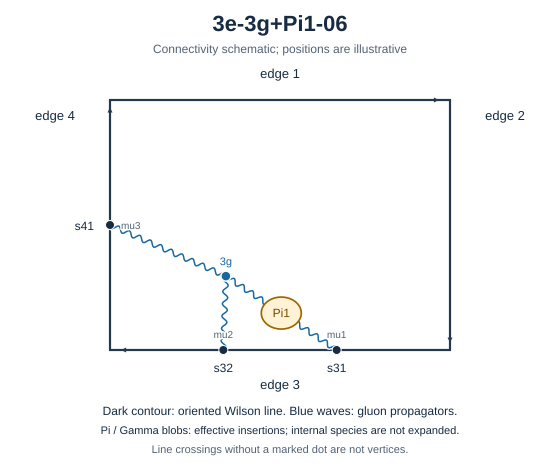

# 3e-3g+Pi1-06

Family: legs. Native Hlog arguments and the integral meaning of `rho` are retained. The scale logarithm L enters only after multiplying the sum by S3.

[Original source result](sources/benchmarks/self-energy/tgv-pi1/results/3e-3g+Pi1-06/r003.json) · [Complete raw ledger](diagram-ledger.json) · [Conventions](conventions.md)

## Native coefficients

The exact original field, zero provenance and raw syntax are recorded in `native_unweighted` in the ledger. The normalized expressions below do not apply a new r-to-z transformation.

### Native coefficient of $\epsilon^{-6}$

\[
0
\]
### Native coefficient of $\epsilon^{-5}$

\[
\frac{1}{1152}
\]
### Native coefficient of $\epsilon^{-4}$

\[
- \frac{1}{1536}
\]
### Native coefficient of $\epsilon^{-3}$

\[
- \frac{73}{9216} + \frac{5 \pi^{2}}{4608}
\]
### Native coefficient of $\epsilon^{-2}$

\[
- \frac{527}{18432} + \frac{13 \zeta\left(3\right)}{1152} + \frac{41 \pi^{2}}{18432}
\]
### Native coefficient of $\epsilon^{-1}$

\[
- \frac{1447}{12288} + \frac{7 \pi^{2}}{36864} + \frac{43 \zeta\left(3\right)}{1536} + \frac{29 \pi^{4}}{36864}
\]
### Native coefficient of $\epsilon^{0}$

\[
\begin{aligned}& - \frac{26863}{73728} + \frac{167 \zeta\left(3\right)}{9216} + \frac{91 \pi^{2}}{24576} + \frac{47 \zeta\left(5\right)}{640} + \frac{41 \pi^{2} \zeta\left(3\right)}{4608}\\ & {} + \frac{4519 \pi^{4}}{2211840}\end{aligned}
\]
## Af color-weighted contribution

Each coefficient is after the declared external multiplier/convolution and before S3.

### Weighted coefficient of $\epsilon^{-6}$

\[
0
\]
### Weighted coefficient of $\epsilon^{-5}$

\[
- \frac{1}{432}
\]
### Weighted coefficient of $\epsilon^{-4}$

\[
\frac{13}{5184}
\]
### Weighted coefficient of $\epsilon^{-3}$

\[
\frac{655}{31104} - \frac{5 \pi^{2}}{1728}
\]
### Weighted coefficient of $\epsilon^{-2}$

\[
- \frac{103 \pi^{2}}{20736} - \frac{13 \zeta\left(3\right)}{432} + \frac{12907}{186624}
\]
### Weighted coefficient of $\epsilon^{-1}$

\[
- \frac{29 \pi^{4}}{13824} - \frac{335 \zeta\left(3\right)}{5184} + \frac{263 \pi^{2}}{124416} + \frac{317875}{1119744}
\]
### Weighted coefficient of $\epsilon^{0}$

\[
\begin{aligned}& - \frac{1313 \pi^{4}}{276480} - \frac{41 \pi^{2} \zeta\left(3\right)}{1728} - \frac{47 \zeta\left(5\right)}{240} - \frac{5941 \pi^{2}}{746496}\\ & {} - \frac{521 \zeta\left(3\right)}{31104} + \frac{5689483}{6718464}\end{aligned}
\]
