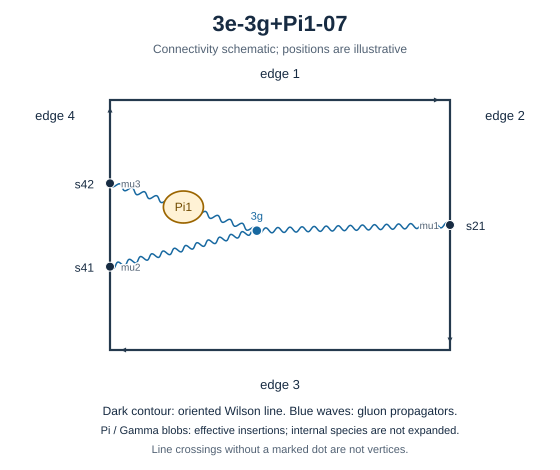

# 3e-3g+Pi1-07

Family: legs. Native Hlog arguments and the integral meaning of `rho` are retained. The scale logarithm L enters only after multiplying the sum by S3.

[Original source result](sources/benchmarks/self-energy/tgv-pi1/results/3e-3g+Pi1-07/r003.json) · [Complete raw ledger](diagram-ledger.json) · [Conventions](conventions.md)

## Native coefficients

The exact original field, zero provenance and raw syntax are recorded in `native_unweighted` in the ledger. The normalized expressions below do not apply a new r-to-z transformation.

### Native coefficient of $\epsilon^{-6}$

\[
0
\]
### Native coefficient of $\epsilon^{-5}$

\[
0
\]
### Native coefficient of $\epsilon^{-4}$

\[
0
\]
### Native coefficient of $\epsilon^{-3}$

\[
\frac{1}{768}
\]
### Native coefficient of $\epsilon^{-2}$

\[
\begin{aligned}& \frac{\pi^{2} G(0;r)}{256} + \frac{G(0,0;r)}{64} + \frac{G(0,0,0;r)}{128} - \frac{G(0,0,1;r)}{128} - \frac{G(0,1;r)}{64} - \frac{G(0,1,0;r)}{128} + \frac{G(0,1,1;r)}{128}\\ & {} + \frac{\pi^{2} G(1;r)}{256} - \frac{G(1,0;r)}{64} + \frac{G(1,0,0;r)}{128} - \frac{G(1,0,1;r)}{128} + \frac{G(1,1;r)}{64} - \frac{G(1,1,0;r)}{128}\\ & {} + \frac{G(1,1,1;r)}{128} - \frac{\zeta\left(3\right)}{64} - \frac{5}{768} + \frac{\pi^{2}}{128}\end{aligned}
\]
### Native coefficient of $\epsilon^{-1}$

\[
\begin{aligned}& - G(0;r) \left(\frac{\pi^{2} r}{3072} - \frac{65 \pi^{2}}{3072} + \frac{3 \zeta\left(3\right)}{128}\right) - G(0,0;r) \left(- \frac{87}{1024} - \frac{\pi^{2}}{512}\right)\\ & {} - G(0,0,0;r) \left(\frac{r}{512} - \frac{11}{256}\right) + \frac{3 G(0,0,0,0;r)}{256} - \frac{3 G(0,0,0,1;r)}{256}\\ & {} - G(0,0,1;r) \left(\frac{11}{256} - \frac{r}{512}\right) - \frac{3 G(0,0,1,0;r)}{256} + \frac{3 G(0,0,1,1;r)}{256}\\ & {} - G(0,1;r) \left(\frac{87}{1024} - \frac{5 \pi^{2}}{512}\right) - G(0,1,0;r) \left(\frac{11}{256} - \frac{r}{512}\right) + \frac{3 G(0,1,0,0;r)}{256}\\ & {} - \frac{3 G(0,1,0,1;r)}{256} - G(0,1,1;r) \left(\frac{r}{512} - \frac{11}{256}\right) - \frac{3 G(0,1,1,0;r)}{256} + \frac{3 G(0,1,1,1;r)}{256}\\ & {} - G(1;r) \left(- \frac{\pi^{2} r}{3072} - \frac{\pi^{2}}{48} + \frac{3 \zeta\left(3\right)}{128}\right) - G(1,0;r) \left(\frac{87}{1024} - \frac{5 \pi^{2}}{512}\right)\\ & {} - G(1,0,0;r) \left(- \frac{r}{512} - \frac{21}{512}\right) + \frac{3 G(1,0,0,0;r)}{256} - \frac{3 G(1,0,0,1;r)}{256}\\ & {} - G(1,0,1;r) \left(\frac{r}{512} + \frac{21}{512}\right) - \frac{3 G(1,0,1,0;r)}{256} + \frac{3 G(1,0,1,1;r)}{256}\\ & {} - G(1,1;r) \left(- \frac{87}{1024} - \frac{\pi^{2}}{512}\right) - G(1,1,0;r) \left(\frac{r}{512} + \frac{21}{512}\right) + \frac{3 G(1,1,0,0;r)}{256}\\ & {} - \frac{3 G(1,1,0,1;r)}{256} - G(1,1,1;r) \left(- \frac{r}{512} - \frac{21}{512}\right) - \frac{3 G(1,1,1,0;r)}{256} + \frac{3 G(1,1,1,1;r)}{256}\\ & {} - \frac{43 \zeta\left(3\right)}{512} - \frac{1}{192} + \frac{\pi^{4}}{10240} + \frac{275 \pi^{2}}{6144}\end{aligned}
\]
### Native coefficient of $\epsilon^{0}$

\[
\begin{aligned}& - G(0;r) \left(\frac{\pi^{2} r}{3072} - \frac{995 \pi^{2}}{12288} - \frac{209 \pi^{4}}{61440} + \frac{129 \zeta\left(3\right)}{1024}\right)\\ & {} - G(0,0;r) \left(- \frac{667}{2048} - \frac{5 \pi^{2}}{512} + \frac{9 \zeta\left(3\right)}{256}\right)\\ & {} - G(0,0,0;r) \left(\frac{r}{512} - \frac{333}{2048} + \frac{47 \pi^{2}}{3072}\right) - \frac{27 G(0,0,0,0;r)}{256} - \frac{71 G(0,0,0,0,0;r)}{512}\\ & {} + \frac{71 G(0,0,0,0,1;r)}{512} + \frac{27 G(0,0,0,1;r)}{256} + \frac{71 G(0,0,0,1,0;r)}{512} - \frac{71 G(0,0,0,1,1;r)}{512}\\ & {} - G(0,0,1;r) \left(- \frac{r}{512} - \frac{47 \pi^{2}}{3072} + \frac{333}{2048}\right) + \frac{27 G(0,0,1,0;r)}{256} + \frac{71 G(0,0,1,0,0;r)}{512}\\ & {} - \frac{71 G(0,0,1,0,1;r)}{512} - \frac{27 G(0,0,1,1;r)}{256} - \frac{71 G(0,0,1,1,0;r)}{512} + \frac{71 G(0,0,1,1,1;r)}{512}\\ & {} - G(0,1;r) \left(- \frac{109 \pi^{2}}{2048} + \frac{9 \zeta\left(3\right)}{256} + \frac{667}{2048}\right)\\ & {} - G(0,1,0;r) \left(- \frac{r}{512} - \frac{47 \pi^{2}}{3072} + \frac{333}{2048}\right) + \frac{237 G(0,1,0,0;r)}{1024} + \frac{35 G(0,1,0,0,0;r)}{512}\\ & {} - \frac{35 G(0,1,0,0,1;r)}{512} - \frac{237 G(0,1,0,1;r)}{1024} - \frac{35 G(0,1,0,1,0;r)}{512} + \frac{35 G(0,1,0,1,1;r)}{512}\\ & {} - G(0,1,1;r) \left(\frac{r}{512} - \frac{61 \pi^{2}}{3072} - \frac{333}{2048}\right) - \frac{237 G(0,1,1,0;r)}{1024} + \frac{G(0,1,1,0,0;r)}{512}\\ & {} - \frac{G(0,1,1,0,1;r)}{512} + \frac{237 G(0,1,1,1;r)}{1024} - \frac{G(0,1,1,1,0;r)}{512} + \frac{G(0,1,1,1,1;r)}{512}\\ & {} - G(1;r) \left(- \frac{\pi^{2} r}{3072} - \frac{991 \pi^{2}}{12288} - \frac{209 \pi^{4}}{61440} + \frac{129 \zeta\left(3\right)}{1024}\right)\\ & {} - G(1,0;r) \left(- \frac{109 \pi^{2}}{2048} + \frac{9 \zeta\left(3\right)}{256} + \frac{667}{2048}\right)\\ & {} - G(1,0,0;r) \left(- \frac{r}{512} - \frac{61 \pi^{2}}{3072} - \frac{329}{2048}\right) + \frac{237 G(1,0,0,0;r)}{1024} + \frac{G(1,0,0,0,0;r)}{512}\\ & {} - \frac{G(1,0,0,0,1;r)}{512} - \frac{237 G(1,0,0,1;r)}{1024} - \frac{G(1,0,0,1,0;r)}{512} + \frac{G(1,0,0,1,1;r)}{512}\\ & {} - G(1,0,1;r) \left(\frac{r}{512} - \frac{47 \pi^{2}}{3072} + \frac{329}{2048}\right) - \frac{237 G(1,0,1,0;r)}{1024} + \frac{35 G(1,0,1,0,0;r)}{512}\\ & {} - \frac{35 G(1,0,1,0,1;r)}{512} + \frac{237 G(1,0,1,1;r)}{1024} - \frac{35 G(1,0,1,1,0;r)}{512} + \frac{35 G(1,0,1,1,1;r)}{512}\\ & {} - G(1,1;r) \left(- \frac{667}{2048} - \frac{5 \pi^{2}}{512} + \frac{9 \zeta\left(3\right)}{256}\right)\\ & {} - G(1,1,0;r) \left(\frac{r}{512} - \frac{47 \pi^{2}}{3072} + \frac{329}{2048}\right) - \frac{27 G(1,1,0,0;r)}{256} + \frac{71 G(1,1,0,0,0;r)}{512}\\ & {} - \frac{71 G(1,1,0,0,1;r)}{512} + \frac{27 G(1,1,0,1;r)}{256} - \frac{71 G(1,1,0,1,0;r)}{512} + \frac{71 G(1,1,0,1,1;r)}{512}\\ & {} - G(1,1,1;r) \left(- \frac{r}{512} - \frac{329}{2048} + \frac{47 \pi^{2}}{3072}\right) + \frac{27 G(1,1,1,0;r)}{256} - \frac{71 G(1,1,1,0,0;r)}{512}\\ & {} + \frac{71 G(1,1,1,0,1;r)}{512} - \frac{27 G(1,1,1,1;r)}{256} + \frac{71 G(1,1,1,1,0;r)}{512} - \frac{71 G(1,1,1,1,1;r)}{512} - \frac{917 \zeta\left(3\right)}{3072}\\ & {} - \frac{31 \pi^{2} \zeta\left(3\right)}{1536} - \frac{37 \zeta\left(5\right)}{256} - \frac{35}{512} + \frac{147 \pi^{4}}{20480} + \frac{1957 \pi^{2}}{12288}\end{aligned}
\]
## Af color-weighted contribution

Each coefficient is after the declared external multiplier/convolution and before S3.

### Weighted coefficient of $\epsilon^{-6}$

\[
0
\]
### Weighted coefficient of $\epsilon^{-5}$

\[
0
\]
### Weighted coefficient of $\epsilon^{-4}$

\[
0
\]
### Weighted coefficient of $\epsilon^{-3}$

\[
- \frac{1}{288}
\]
### Weighted coefficient of $\epsilon^{-2}$

\[
\begin{aligned}& - \frac{\pi^{2} G(0;r)}{96} - \frac{G(0,0;r)}{24} - \frac{G(0,0,0;r)}{48} + \frac{G(0,0,1;r)}{48} + \frac{G(0,1;r)}{24} + \frac{G(0,1,0;r)}{48} - \frac{G(0,1,1;r)}{48}\\ & {} - \frac{\pi^{2} G(1;r)}{96} + \frac{G(1,0;r)}{24} - \frac{G(1,0,0;r)}{48} + \frac{G(1,0,1;r)}{48} - \frac{G(1,1;r)}{24} + \frac{G(1,1,0;r)}{48} - \frac{G(1,1,1;r)}{48}\\ & {} - \frac{\pi^{2}}{48} + \frac{1}{54} + \frac{\zeta\left(3\right)}{24}\end{aligned}
\]
### Weighted coefficient of $\epsilon^{-1}$

\[
\begin{aligned}& \frac{\pi^{2} G(0;r) r}{1152} - \frac{61 \pi^{2} G(0;r)}{1152} + \frac{G(0;r) \zeta\left(3\right)}{16} - \frac{245 G(0,0;r)}{1152} - \frac{\pi^{2} G(0,0;r)}{192}\\ & {} + \frac{G(0,0,0;r) r}{192} - \frac{31 G(0,0,0;r)}{288} - \frac{G(0,0,0,0;r)}{32} + \frac{G(0,0,0,1;r)}{32} - \frac{G(0,0,1;r) r}{192} + \frac{31 G(0,0,1;r)}{288}\\ & {} + \frac{G(0,0,1,0;r)}{32} - \frac{G(0,0,1,1;r)}{32} - \frac{5 \pi^{2} G(0,1;r)}{192} + \frac{245 G(0,1;r)}{1152} - \frac{G(0,1,0;r) r}{192} + \frac{31 G(0,1,0;r)}{288}\\ & {} - \frac{G(0,1,0,0;r)}{32} + \frac{G(0,1,0,1;r)}{32} + \frac{G(0,1,1;r) r}{192} - \frac{31 G(0,1,1;r)}{288} + \frac{G(0,1,1,0;r)}{32} - \frac{G(0,1,1,1;r)}{32}\\ & {} - \frac{\pi^{2} G(1;r) r}{1152} - \frac{5 \pi^{2} G(1;r)}{96} + \frac{G(1;r) \zeta\left(3\right)}{16} - \frac{5 \pi^{2} G(1,0;r)}{192} + \frac{245 G(1,0;r)}{1152}\\ & {} - \frac{G(1,0,0;r) r}{192} - \frac{59 G(1,0,0;r)}{576} - \frac{G(1,0,0,0;r)}{32} + \frac{G(1,0,0,1;r)}{32} + \frac{G(1,0,1;r) r}{192} + \frac{59 G(1,0,1;r)}{576}\\ & {} + \frac{G(1,0,1,0;r)}{32} - \frac{G(1,0,1,1;r)}{32} - \frac{245 G(1,1;r)}{1152} - \frac{\pi^{2} G(1,1;r)}{192} + \frac{G(1,1,0;r) r}{192} + \frac{59 G(1,1,0;r)}{576}\\ & {} - \frac{G(1,1,0,0;r)}{32} + \frac{G(1,1,0,1;r)}{32} - \frac{G(1,1,1;r) r}{192} - \frac{59 G(1,1,1;r)}{576} + \frac{G(1,1,1,0;r)}{32} - \frac{G(1,1,1,1;r)}{32}\\ & {} - \frac{259 \pi^{2}}{2304} - \frac{\pi^{4}}{3840} + \frac{23}{2592} + \frac{121 \zeta\left(3\right)}{576}\end{aligned}
\]
### Weighted coefficient of $\epsilon^{0}$

\[
\begin{aligned}& \frac{\pi^{2} G(0;r) r}{1728} - \frac{2693 \pi^{2} G(0;r)}{13824} - \frac{209 \pi^{4} G(0;r)}{23040} + \frac{121 G(0;r) \zeta\left(3\right)}{384}\\ & {} - \frac{5417 G(0,0;r)}{6912} - \frac{7 \pi^{2} G(0,0;r)}{288} + \frac{3 G(0,0;r) \zeta\left(3\right)}{32} + \frac{G(0,0,0;r) r}{288} - \frac{2701 G(0,0,0;r)}{6912}\\ & {} + \frac{47 \pi^{2} G(0,0,0;r)}{1152} + \frac{7 G(0,0,0,0;r)}{24} + \frac{71 G(0,0,0,0,0;r)}{192} - \frac{71 G(0,0,0,0,1;r)}{192} - \frac{7 G(0,0,0,1;r)}{24}\\ & {} - \frac{71 G(0,0,0,1,0;r)}{192} + \frac{71 G(0,0,0,1,1;r)}{192} - \frac{G(0,0,1;r) r}{288} - \frac{47 \pi^{2} G(0,0,1;r)}{1152} + \frac{2701 G(0,0,1;r)}{6912}\\ & {} - \frac{7 G(0,0,1,0;r)}{24} - \frac{71 G(0,0,1,0,0;r)}{192} + \frac{71 G(0,0,1,0,1;r)}{192} + \frac{7 G(0,0,1,1;r)}{24} + \frac{71 G(0,0,1,1,0;r)}{192}\\ & {} - \frac{71 G(0,0,1,1,1;r)}{192} - \frac{307 \pi^{2} G(0,1;r)}{2304} + \frac{3 G(0,1;r) \zeta\left(3\right)}{32} + \frac{5417 G(0,1;r)}{6912} - \frac{G(0,1,0;r) r}{288}\\ & {} - \frac{47 \pi^{2} G(0,1,0;r)}{1152} + \frac{2701 G(0,1,0;r)}{6912} - \frac{233 G(0,1,0,0;r)}{384} - \frac{35 G(0,1,0,0,0;r)}{192} + \frac{35 G(0,1,0,0,1;r)}{192}\\ & {} + \frac{233 G(0,1,0,1;r)}{384} + \frac{35 G(0,1,0,1,0;r)}{192} - \frac{35 G(0,1,0,1,1;r)}{192} + \frac{G(0,1,1;r) r}{288} - \frac{61 \pi^{2} G(0,1,1;r)}{1152}\\ & {} - \frac{2701 G(0,1,1;r)}{6912} + \frac{233 G(0,1,1,0;r)}{384} - \frac{G(0,1,1,0,0;r)}{192} + \frac{G(0,1,1,0,1;r)}{192} - \frac{233 G(0,1,1,1;r)}{384}\\ & {} + \frac{G(0,1,1,1,0;r)}{192} - \frac{G(0,1,1,1,1;r)}{192} - \frac{\pi^{2} G(1;r) r}{1728} - \frac{895 \pi^{2} G(1;r)}{4608} - \frac{209 \pi^{4} G(1;r)}{23040}\\ & {} + \frac{121 G(1;r) \zeta\left(3\right)}{384} - \frac{307 \pi^{2} G(1,0;r)}{2304} + \frac{3 G(1,0;r) \zeta\left(3\right)}{32} + \frac{5417 G(1,0;r)}{6912}\\ & {} - \frac{G(1,0,0;r) r}{288} - \frac{61 \pi^{2} G(1,0,0;r)}{1152} - \frac{2677 G(1,0,0;r)}{6912} - \frac{233 G(1,0,0,0;r)}{384} - \frac{G(1,0,0,0,0;r)}{192}\\ & {} + \frac{G(1,0,0,0,1;r)}{192} + \frac{233 G(1,0,0,1;r)}{384} + \frac{G(1,0,0,1,0;r)}{192} - \frac{G(1,0,0,1,1;r)}{192} + \frac{G(1,0,1;r) r}{288}\\ & {} - \frac{47 \pi^{2} G(1,0,1;r)}{1152} + \frac{2677 G(1,0,1;r)}{6912} + \frac{233 G(1,0,1,0;r)}{384} - \frac{35 G(1,0,1,0,0;r)}{192} + \frac{35 G(1,0,1,0,1;r)}{192}\\ & {} - \frac{233 G(1,0,1,1;r)}{384} + \frac{35 G(1,0,1,1,0;r)}{192} - \frac{35 G(1,0,1,1,1;r)}{192} - \frac{5417 G(1,1;r)}{6912} - \frac{7 \pi^{2} G(1,1;r)}{288}\\ & {} + \frac{3 G(1,1;r) \zeta\left(3\right)}{32} + \frac{G(1,1,0;r) r}{288} - \frac{47 \pi^{2} G(1,1,0;r)}{1152} + \frac{2677 G(1,1,0;r)}{6912} + \frac{7 G(1,1,0,0;r)}{24}\\ & {} - \frac{71 G(1,1,0,0,0;r)}{192} + \frac{71 G(1,1,0,0,1;r)}{192} - \frac{7 G(1,1,0,1;r)}{24} + \frac{71 G(1,1,0,1,0;r)}{192} - \frac{71 G(1,1,0,1,1;r)}{192}\\ & {} - \frac{G(1,1,1;r) r}{288} - \frac{2677 G(1,1,1;r)}{6912} + \frac{47 \pi^{2} G(1,1,1;r)}{1152} - \frac{7 G(1,1,1,0;r)}{24} + \frac{71 G(1,1,1,0,0;r)}{192}\\ & {} - \frac{71 G(1,1,1,0,1;r)}{192} + \frac{7 G(1,1,1,1;r)}{24} - \frac{71 G(1,1,1,1,0;r)}{192} + \frac{71 G(1,1,1,1,1;r)}{192} - \frac{5257 \pi^{2}}{13824}\\ & {} - \frac{439 \pi^{4}}{23040} + \frac{2711}{15552} + \frac{37 \zeta\left(5\right)}{96} + \frac{31 \pi^{2} \zeta\left(3\right)}{576} + \frac{2461 \zeta\left(3\right)}{3456}\end{aligned}
\]
