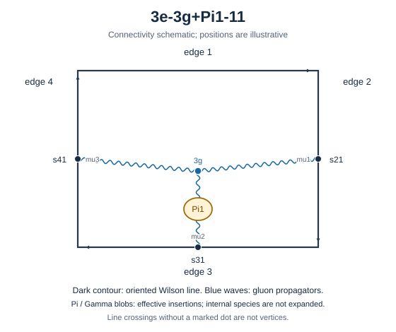

# 3e-3g+Pi1-11

Family: legs. Native Hlog arguments and the integral meaning of `rho` are retained. The scale logarithm L enters only after multiplying the sum by S3.

[Original source result](sources/benchmarks/self-energy/tgv-pi1/results/3e-3g+Pi1-11/r003.json) · [Complete raw ledger](diagram-ledger.json) · [Conventions](conventions.md)

## Native coefficients

The exact original field, zero provenance and raw syntax are recorded in `native_unweighted` in the ledger. The normalized expressions below do not apply a new r-to-z transformation.

### Native coefficient of $\epsilon^{-6}$

\[
0
\]
### Native coefficient of $\epsilon^{-5}$

\[
0
\]
### Native coefficient of $\epsilon^{-4}$

\[
0
\]
### Native coefficient of $\epsilon^{-3}$

\[
- \frac{1}{384} + \frac{\pi^{2}}{1152}
\]
### Native coefficient of $\epsilon^{-2}$

\[
\begin{aligned}& - \frac{\pi^{2} G(-1;z)}{128} - \frac{G(-1,0,0;z)}{64} + \frac{\rho^{3}}{768} - \frac{3 \rho^{2}}{512} + \frac{\pi^{2} \rho}{256} - \frac{19 \pi^{2}}{4608}\\ & {} - \frac{\zeta\left(3\right)}{96} - \frac{1}{384}\end{aligned}
\]
### Native coefficient of $\epsilon^{-1}$

\[
\begin{aligned}& - \frac{7 \pi^{2} G(0,-1;z)}{256} - \frac{7 G(0,-1,0,0;z)}{128} - G(-1;z) \left(- \frac{7 \zeta\left(3\right)}{64} - \frac{\pi^{2}}{128}\right)\\ & {} - \frac{7 \pi^{2} G(-1,0;z)}{256} + \frac{G(-1,0,0;z)}{64} - \frac{7 G(-1,0,0,0;z)}{128} + \frac{7 \pi^{2} G(-1,-1;z)}{128} + \frac{7 G(-1,-1,0,0;z)}{64}\\ & {} + \frac{\rho^{4}}{512} - \frac{\rho^{3} \left(\frac{3 z}{512} + \frac{5}{512}\right)}{6 z + 6} - \frac{\rho^{2} \left(\frac{3}{256} - \frac{5 \pi^{2}}{384}\right)}{2}\\ & {} - \frac{\rho \left(\frac{11 \pi^{2} z}{3072} + \frac{7 z \zeta\left(3\right)}{128} + \frac{13 \pi^{2}}{3072} + \frac{7 \zeta\left(3\right)}{128}\right)}{z + 1}\\ & {} - \frac{\pi^{2}}{144} - \frac{3}{128} + \frac{5 \zeta\left(3\right)}{192} + \frac{89 \pi^{4}}{13824}\end{aligned}
\]
### Native coefficient of $\epsilon^{0}$

\[
\begin{aligned}& - \frac{7 \pi^{2} G(0,0,-1;z)}{128} - \frac{7 G(0,0,-1,0,0;z)}{64} - G(0,-1;z) \left(- \frac{27 \zeta\left(3\right)}{128} + \frac{5 \pi^{2}}{256}\right)\\ & {} - \frac{\pi^{2} G(0,-1,0;z)}{24} - \frac{5 G(0,-1,0,0;z)}{128} - \frac{5 G(0,-1,0,0,0;z)}{128} + \frac{27 \pi^{2} G(0,-1,-1;z)}{256} + \frac{27 G(0,-1,-1,0,0;z)}{128}\\ & {} - G(-1;z) \left(- \frac{5 \zeta\left(3\right)}{64} + \frac{\pi^{2}}{128} + \frac{103 \pi^{4}}{7680}\right)\\ & {} - G(-1,0;z) \left(- \frac{27 \zeta\left(3\right)}{128} + \frac{5 \pi^{2}}{256}\right) - G(-1,0,0;z) \left(\frac{1}{64} + \frac{25 \pi^{2}}{768}\right)\\ & {} - \frac{5 G(-1,0,0,0;z)}{128} + \frac{G(-1,0,0,0,0;z)}{64} + \frac{27 \pi^{2} G(-1,0,-1;z)}{256} + \frac{27 G(-1,0,-1,0,0;z)}{128}\\ & {} - G(-1,-1;z) \left(- \frac{5 \pi^{2}}{128} + \frac{27 \zeta\left(3\right)}{64}\right) + \frac{27 \pi^{2} G(-1,-1,0;z)}{256} + \frac{5 G(-1,-1,0,0;z)}{64}\\ & {} + \frac{27 G(-1,-1,0,0,0;z)}{128} - \frac{27 \pi^{2} G(-1,-1,-1;z)}{128} - \frac{27 G(-1,-1,-1,0,0;z)}{64} - \frac{\rho^{5}}{3072} + \frac{15 \rho^{4}}{2048}\\ & {} + \frac{\rho^{3} \left(\frac{5 z}{512} + \frac{3 \pi^{2} z}{256} + \frac{3}{512} + \frac{3 \pi^{2}}{256}\right)}{6 z + 6}\\ & {} - \frac{\rho^{2} \left(- \frac{59 \pi^{2}}{3072} + \frac{9}{256} + \frac{11 \zeta\left(3\right)}{64}\right)}{2}\\ & {} + \frac{\rho \left(- \frac{5 z \zeta\left(3\right)}{128} + \frac{13 \pi^{2} z}{3072} + \frac{197 \pi^{4} z}{23040} - \frac{5 \zeta\left(3\right)}{128} + \frac{11 \pi^{2}}{3072} + \frac{197 \pi^{4}}{23040}\right)}{z + 1}\\ & {} - \frac{41 \pi^{2} \zeta\left(3\right)}{288} - \frac{5 \zeta\left(5\right)}{12} - \frac{17 \pi^{2}}{2304} - \frac{17 \zeta\left(3\right)}{384} - \frac{17}{384}\\ & {} + \frac{997 \pi^{4}}{138240}\end{aligned}
\]
## Af color-weighted contribution

Each coefficient is after the declared external multiplier/convolution and before S3.

### Weighted coefficient of $\epsilon^{-6}$

\[
0
\]
### Weighted coefficient of $\epsilon^{-5}$

\[
0
\]
### Weighted coefficient of $\epsilon^{-4}$

\[
0
\]
### Weighted coefficient of $\epsilon^{-3}$

\[
\frac{1}{144} - \frac{\pi^{2}}{432}
\]
### Weighted coefficient of $\epsilon^{-2}$

\[
\begin{aligned}& \frac{\pi^{2} G(-1;z)}{48} + \frac{G(-1,0,0;z)}{24} - \frac{\rho^{3}}{288} + \frac{\rho^{2}}{64} - \frac{\pi^{2} \rho}{96} + \frac{1}{216}\\ & {} + \frac{\zeta\left(3\right)}{36} + \frac{61 \pi^{2}}{5184}\end{aligned}
\]
### Weighted coefficient of $\epsilon^{-1}$

\[
\frac{2268 \pi^{2} G(0,-1;z) z + 2268 \pi^{2} G(0,-1;z) + 4536 G(0,-1,0,0;z) z + 4536 G(0,-1,0,0;z) - 9072 G(-1;z) z \zeta\left(3\right) - 864 \pi^{2} G(-1;z) z - 9072 G(-1;z) \zeta\left(3\right) - 864 \pi^{2} G(-1;z) + 2268 \pi^{2} G(-1,0;z) z + 2268 \pi^{2} G(-1,0;z) - 1728 G(-1,0,0;z) z - 1728 G(-1,0,0;z) + 4536 G(-1,0,0,0;z) z + 4536 G(-1,0,0,0;z) - 4536 \pi^{2} G(-1,-1;z) z - 4536 \pi^{2} G(-1,-1;z) - 9072 G(-1,-1,0,0;z) z - 9072 G(-1,-1,0,0;z) - 162 \rho^{4} z - 162 \rho^{4} + 117 \rho^{3} z + 171 \rho^{3} - 540 \pi^{2} \rho^{2} z + 324 \rho^{2} z - 540 \pi^{2} \rho^{2} + 324 \rho^{2} + 405 \pi^{2} \rho z + 4536 \rho z \zeta\left(3\right) + 459 \pi^{2} \rho + 4536 \rho \zeta\left(3\right) - 534 \pi^{4} z - 2448 z \zeta\left(3\right) + 1824 z + 478 \pi^{2} z - 534 \pi^{4} - 2448 \zeta\left(3\right) + 1824 + 478 \pi^{2}}{31104 z + 31104}
\]
### Weighted coefficient of $\epsilon^{0}$

\[
\frac{136080 \pi^{2} G(0,0,-1;z) z + 136080 \pi^{2} G(0,0,-1;z) + 272160 G(0,0,-1,0,0;z) z + 272160 G(0,0,-1,0,0;z) - 524880 G(0,-1;z) z \zeta\left(3\right) + 25920 \pi^{2} G(0,-1;z) z - 524880 G(0,-1;z) \zeta\left(3\right) + 25920 \pi^{2} G(0,-1;z) + 103680 \pi^{2} G(0,-1,0;z) z + 103680 \pi^{2} G(0,-1,0;z) + 51840 G(0,-1,0,0;z) z + 51840 G(0,-1,0,0;z) + 97200 G(0,-1,0,0,0;z) z + 97200 G(0,-1,0,0,0;z) - 262440 \pi^{2} G(0,-1,-1;z) z - 262440 \pi^{2} G(0,-1,-1;z) - 524880 G(0,-1,-1,0,0;z) z - 524880 G(0,-1,-1,0,0;z) - 103680 G(-1;z) z \zeta\left(3\right) + 21600 \pi^{2} G(-1;z) z + 33372 \pi^{4} G(-1;z) z - 103680 G(-1;z) \zeta\left(3\right) + 21600 \pi^{2} G(-1;z) + 33372 \pi^{4} G(-1;z) - 524880 G(-1,0;z) z \zeta\left(3\right) + 25920 \pi^{2} G(-1,0;z) z - 524880 G(-1,0;z) \zeta\left(3\right) + 25920 \pi^{2} G(-1,0;z) + 43200 G(-1,0,0;z) z + 81000 \pi^{2} G(-1,0,0;z) z + 43200 G(-1,0,0;z) + 81000 \pi^{2} G(-1,0,0;z) + 51840 G(-1,0,0,0;z) z + 51840 G(-1,0,0,0;z) - 38880 G(-1,0,0,0,0;z) z - 38880 G(-1,0,0,0,0;z) - 262440 \pi^{2} G(-1,0,-1;z) z - 262440 \pi^{2} G(-1,0,-1;z) - 524880 G(-1,0,-1,0,0;z) z - 524880 G(-1,0,-1,0,0;z) - 51840 \pi^{2} G(-1,-1;z) z + 1049760 G(-1,-1;z) z \zeta\left(3\right) - 51840 \pi^{2} G(-1,-1;z) + 1049760 G(-1,-1;z) \zeta\left(3\right) - 262440 \pi^{2} G(-1,-1,0;z) z - 262440 \pi^{2} G(-1,-1,0;z) - 103680 G(-1,-1,0,0;z) z - 103680 G(-1,-1,0,0;z) - 524880 G(-1,-1,0,0,0;z) z - 524880 G(-1,-1,0,0,0;z) + 524880 \pi^{2} G(-1,-1,-1;z) z + 524880 \pi^{2} G(-1,-1,-1;z) + 1049760 G(-1,-1,-1,0,0;z) z + 1049760 G(-1,-1,-1,0,0;z) + 810 \rho^{5} z + 810 \rho^{5} - 16605 \rho^{4} z - 16605 \rho^{4} - 4860 \pi^{2} \rho^{3} z - 4140 \rho^{3} z - 4860 \pi^{2} \rho^{3} - 3060 \rho^{3} - 18495 \pi^{2} \rho^{2} z + 35640 \rho^{2} z + 213840 \rho^{2} z \zeta\left(3\right) - 18495 \pi^{2} \rho^{2} + 35640 \rho^{2} + 213840 \rho^{2} \zeta\left(3\right) - 21276 \pi^{4} \rho z - 11340 \pi^{2} \rho z + 51840 \rho z \zeta\left(3\right) - 21276 \pi^{4} \rho - 10260 \pi^{2} \rho + 51840 \rho \zeta\left(3\right) - 12606 \pi^{4} z + 88320 z + 10640 \pi^{2} z + 126000 z \zeta\left(3\right) + 1036800 z \zeta\left(5\right) + 354240 \pi^{2} z \zeta\left(3\right) - 12606 \pi^{4} + 88320 + 10640 \pi^{2} + 126000 \zeta\left(3\right) + 1036800 \zeta\left(5\right) + 354240 \pi^{2} \zeta\left(3\right)}{933120 z + 933120}
\]
