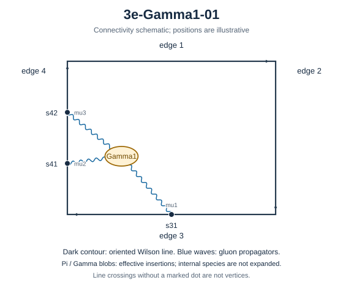

# 3e-Gamma1-01

Family: Gamma. Native Hlog arguments and the integral meaning of `rho` are retained. The scale logarithm L enters only after multiplying the sum by S3.

[Original source result](sources/benchmarks/self-energy/gamma1/results/3e-Gamma1-01/r002.json) · [Complete raw ledger](diagram-ledger.json) · [Conventions](conventions.md)

## Native coefficients

The exact original field, zero provenance and raw syntax are recorded in `native_unweighted` in the ledger. The normalized expressions below do not apply a new r-to-z transformation.

### Native coefficient of $\epsilon^{-6}$

\[
0
\]
### Native coefficient of $\epsilon^{-5}$

\[
\frac{1}{864}
\]
### Native coefficient of $\epsilon^{-4}$

\[
- \frac{7}{2592}
\]
### Native coefficient of $\epsilon^{-3}$

\[
- \frac{131}{7776} + \frac{19 \pi^{2}}{10368}
\]
### Native coefficient of $\epsilon^{-2}$

\[
- \frac{3251}{46656} + \frac{59 \pi^{2}}{31104} + \frac{17 \zeta\left(3\right)}{288}
\]
### Native coefficient of $\epsilon^{-1}$

\[
- \frac{68435}{279936} - \frac{47 \zeta\left(3\right)}{864} + \frac{127 \pi^{2}}{93312} + \frac{827 \pi^{4}}{414720}
\]
### Native coefficient of $\epsilon^{0}$

\[
\begin{aligned}& - \frac{1365323}{1679616} - \frac{305 \zeta\left(3\right)}{2592} - \frac{2921 \pi^{2}}{559872} + \frac{739 \pi^{4}}{1244160} + \frac{11 \pi^{2} \zeta\left(3\right)}{384}\\ & {} + \frac{1331 \zeta\left(5\right)}{1440}\end{aligned}
\]
## Af color-weighted contribution

Each coefficient is after the declared external multiplier/convolution and before S3.

### Weighted coefficient of $\epsilon^{-6}$

\[
0
\]
### Weighted coefficient of $\epsilon^{-5}$

\[
\frac{1}{864}
\]
### Weighted coefficient of $\epsilon^{-4}$

\[
- \frac{7}{2592}
\]
### Weighted coefficient of $\epsilon^{-3}$

\[
- \frac{131}{7776} + \frac{19 \pi^{2}}{10368}
\]
### Weighted coefficient of $\epsilon^{-2}$

\[
- \frac{3251}{46656} + \frac{59 \pi^{2}}{31104} + \frac{17 \zeta\left(3\right)}{288}
\]
### Weighted coefficient of $\epsilon^{-1}$

\[
- \frac{68435}{279936} - \frac{47 \zeta\left(3\right)}{864} + \frac{127 \pi^{2}}{93312} + \frac{827 \pi^{4}}{414720}
\]
### Weighted coefficient of $\epsilon^{0}$

\[
\begin{aligned}& - \frac{1365323}{1679616} - \frac{305 \zeta\left(3\right)}{2592} - \frac{2921 \pi^{2}}{559872} + \frac{739 \pi^{4}}{1244160} + \frac{11 \pi^{2} \zeta\left(3\right)}{384}\\ & {} + \frac{1331 \zeta\left(5\right)}{1440}\end{aligned}
\]
