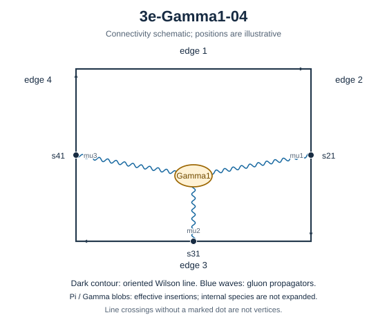

# 3e-Gamma1-04

Family: Gamma. Native Hlog arguments and the integral meaning of `rho` are retained. The scale logarithm L enters only after multiplying the sum by S3.

[Original source result](sources/benchmarks/self-energy/gamma1/results/3e-Gamma1-04/r003.json) · [Complete raw ledger](diagram-ledger.json) · [Conventions](conventions.md)

## Native coefficients

The exact original field, zero provenance and raw syntax are recorded in `native_unweighted` in the ledger. The normalized expressions below do not apply a new r-to-z transformation.

### Native coefficient of $\epsilon^{-6}$

\[
0
\]
### Native coefficient of $\epsilon^{-5}$

\[
0
\]
### Native coefficient of $\epsilon^{-4}$

\[
0
\]
### Native coefficient of $\epsilon^{-3}$

\[
\frac{\pi^{2}}{432}
\]
### Native coefficient of $\epsilon^{-2}$

\[
- \frac{\pi^{2} G(-1;z)}{48} - \frac{G(-1,0,0;z)}{24} + \frac{\rho^{3}}{288} + \frac{\pi^{2} \rho}{96} - \frac{5 \zeta\left(3\right)}{72} + \frac{\pi^{2}}{162}
\]
### Native coefficient of $\epsilon^{-1}$

\[
\begin{aligned}& - \frac{3 \pi^{2} G(0,-1;z)}{32} - \frac{3 G(0,-1,0,0;z)}{16} - G(-1;z) \left(- \frac{3 \zeta\left(3\right)}{8} + \frac{13 \pi^{2}}{288}\right)\\ & {} - \frac{3 \pi^{2} G(-1,0;z)}{32} - \frac{13 G(-1,0,0;z)}{144} - \frac{3 G(-1,0,0,0;z)}{16} + \frac{3 \pi^{2} G(-1,-1;z)}{16} + \frac{3 G(-1,-1,0,0;z)}{8}\\ & {} + \frac{\rho^{4}}{192} - \frac{\rho^{3} \left(- \frac{z}{18} - \frac{5}{144}\right)}{6 z + 6} + \frac{\pi^{2} \rho^{2}}{48}\\ & {} + \frac{\rho \left(- \frac{3 z \zeta\left(3\right)}{16} + \frac{7 \pi^{2} z}{288} - \frac{3 \zeta\left(3\right)}{16} + \frac{\pi^{2}}{48}\right)}{z + 1}\\ & {} - \frac{83 \zeta\left(3\right)}{432} + \frac{13 \pi^{2}}{972} + \frac{11 \pi^{4}}{540}\end{aligned}
\]
### Native coefficient of $\epsilon^{0}$

\[
\begin{aligned}& - \frac{13 \pi^{2} G(0,0,-1;z)}{48} - \frac{13 G(0,0,-1,0,0;z)}{24} - G(0,-1;z) \left(- \frac{41 \zeta\left(3\right)}{48} + \frac{11 \pi^{2}}{64}\right)\\ & {} - \frac{25 \pi^{2} G(0,-1,0;z)}{144} - \frac{11 G(0,-1,0,0;z)}{32} - \frac{3 G(0,-1,0,0,0;z)}{16} + \frac{41 \pi^{2} G(0,-1,-1;z)}{96} + \frac{41 G(0,-1,-1,0,0;z)}{48}\\ & {} - G(-1;z) \left(- \frac{11 \zeta\left(3\right)}{16} + \frac{31 \pi^{2}}{432} + \frac{77 \pi^{4}}{1440}\right)\\ & {} - G(-1,0;z) \left(- \frac{41 \zeta\left(3\right)}{48} + \frac{11 \pi^{2}}{64}\right) - G(-1,0,0;z) \left(\frac{31}{216} + \frac{43 \pi^{2}}{288}\right)\\ & {} - \frac{11 G(-1,0,0,0;z)}{32} - \frac{G(-1,0,0,0,0;z)}{6} + \frac{41 \pi^{2} G(-1,0,-1;z)}{96} + \frac{41 G(-1,0,-1,0,0;z)}{48}\\ & {} - G(-1,-1;z) \left(- \frac{11 \pi^{2}}{32} + \frac{41 \zeta\left(3\right)}{24}\right) + \frac{41 \pi^{2} G(-1,-1,0;z)}{96} + \frac{11 G(-1,-1,0,0;z)}{16}\\ & {} + \frac{41 G(-1,-1,0,0,0;z)}{48} - \frac{41 \pi^{2} G(-1,-1,-1;z)}{48} - \frac{41 G(-1,-1,-1,0,0;z)}{24} + \frac{\rho^{5}}{5760} + \frac{5 \rho^{4}}{576}\\ & {} + \frac{\rho^{3} \left(\frac{17 z}{216} + \frac{\pi^{2} z}{12} + \frac{7}{108} + \frac{\pi^{2}}{12}\right)}{6 z + 6}\\ & {} - \frac{\rho^{2} \left(- \frac{5 \pi^{2}}{72} + \frac{5 \zeta\left(3\right)}{12}\right)}{2}\\ & {} + \frac{\rho \left(- \frac{11 z \zeta\left(3\right)}{32} + \frac{\pi^{2} z}{27} + \frac{35 \pi^{4} z}{864} - \frac{11 \zeta\left(3\right)}{32} + \frac{5 \pi^{2}}{144} + \frac{35 \pi^{4}}{864}\right)}{z + 1}\\ & {} - \frac{307 \pi^{2} \zeta\left(3\right)}{864} - \frac{19 \zeta\left(5\right)}{6} - \frac{65 \zeta\left(3\right)}{648} + \frac{53 \pi^{2}}{2916}\\ & {} + \frac{365 \pi^{4}}{10368}\end{aligned}
\]
## Af color-weighted contribution

Each coefficient is after the declared external multiplier/convolution and before S3.

### Weighted coefficient of $\epsilon^{-6}$

\[
0
\]
### Weighted coefficient of $\epsilon^{-5}$

\[
0
\]
### Weighted coefficient of $\epsilon^{-4}$

\[
0
\]
### Weighted coefficient of $\epsilon^{-3}$

\[
\frac{\pi^{2}}{432}
\]
### Weighted coefficient of $\epsilon^{-2}$

\[
- \frac{\pi^{2} G(-1;z)}{48} - \frac{G(-1,0,0;z)}{24} + \frac{\rho^{3}}{288} + \frac{\pi^{2} \rho}{96} - \frac{5 \zeta\left(3\right)}{72} + \frac{\pi^{2}}{162}
\]
### Weighted coefficient of $\epsilon^{-1}$

\[
\begin{aligned}& - \frac{3 \pi^{2} G(0,-1;z)}{32} - \frac{3 G(0,-1,0,0;z)}{16} - G(-1;z) \left(- \frac{3 \zeta\left(3\right)}{8} + \frac{13 \pi^{2}}{288}\right)\\ & {} - \frac{3 \pi^{2} G(-1,0;z)}{32} - \frac{13 G(-1,0,0;z)}{144} - \frac{3 G(-1,0,0,0;z)}{16} + \frac{3 \pi^{2} G(-1,-1;z)}{16} + \frac{3 G(-1,-1,0,0;z)}{8}\\ & {} + \frac{\rho^{4}}{192} - \frac{\rho^{3} \left(- \frac{z}{18} - \frac{5}{144}\right)}{6 z + 6} + \frac{\pi^{2} \rho^{2}}{48}\\ & {} + \frac{\rho \left(- \frac{3 z \zeta\left(3\right)}{16} + \frac{7 \pi^{2} z}{288} - \frac{3 \zeta\left(3\right)}{16} + \frac{\pi^{2}}{48}\right)}{z + 1}\\ & {} - \frac{83 \zeta\left(3\right)}{432} + \frac{13 \pi^{2}}{972} + \frac{11 \pi^{4}}{540}\end{aligned}
\]
### Weighted coefficient of $\epsilon^{0}$

\[
\begin{aligned}& - \frac{13 \pi^{2} G(0,0,-1;z)}{48} - \frac{13 G(0,0,-1,0,0;z)}{24} - G(0,-1;z) \left(- \frac{41 \zeta\left(3\right)}{48} + \frac{11 \pi^{2}}{64}\right)\\ & {} - \frac{25 \pi^{2} G(0,-1,0;z)}{144} - \frac{11 G(0,-1,0,0;z)}{32} - \frac{3 G(0,-1,0,0,0;z)}{16} + \frac{41 \pi^{2} G(0,-1,-1;z)}{96} + \frac{41 G(0,-1,-1,0,0;z)}{48}\\ & {} - G(-1;z) \left(- \frac{11 \zeta\left(3\right)}{16} + \frac{31 \pi^{2}}{432} + \frac{77 \pi^{4}}{1440}\right)\\ & {} - G(-1,0;z) \left(- \frac{41 \zeta\left(3\right)}{48} + \frac{11 \pi^{2}}{64}\right) - G(-1,0,0;z) \left(\frac{31}{216} + \frac{43 \pi^{2}}{288}\right)\\ & {} - \frac{11 G(-1,0,0,0;z)}{32} - \frac{G(-1,0,0,0,0;z)}{6} + \frac{41 \pi^{2} G(-1,0,-1;z)}{96} + \frac{41 G(-1,0,-1,0,0;z)}{48}\\ & {} - G(-1,-1;z) \left(- \frac{11 \pi^{2}}{32} + \frac{41 \zeta\left(3\right)}{24}\right) + \frac{41 \pi^{2} G(-1,-1,0;z)}{96} + \frac{11 G(-1,-1,0,0;z)}{16}\\ & {} + \frac{41 G(-1,-1,0,0,0;z)}{48} - \frac{41 \pi^{2} G(-1,-1,-1;z)}{48} - \frac{41 G(-1,-1,-1,0,0;z)}{24} + \frac{\rho^{5}}{5760} + \frac{5 \rho^{4}}{576}\\ & {} + \frac{\rho^{3} \left(\frac{17 z}{216} + \frac{\pi^{2} z}{12} + \frac{7}{108} + \frac{\pi^{2}}{12}\right)}{6 z + 6}\\ & {} - \frac{\rho^{2} \left(- \frac{5 \pi^{2}}{72} + \frac{5 \zeta\left(3\right)}{12}\right)}{2}\\ & {} + \frac{\rho \left(- \frac{11 z \zeta\left(3\right)}{32} + \frac{\pi^{2} z}{27} + \frac{35 \pi^{4} z}{864} - \frac{11 \zeta\left(3\right)}{32} + \frac{5 \pi^{2}}{144} + \frac{35 \pi^{4}}{864}\right)}{z + 1}\\ & {} - \frac{307 \pi^{2} \zeta\left(3\right)}{864} - \frac{19 \zeta\left(5\right)}{6} - \frac{65 \zeta\left(3\right)}{648} + \frac{53 \pi^{2}}{2916}\\ & {} + \frac{365 \pi^{4}}{10368}\end{aligned}
\]
