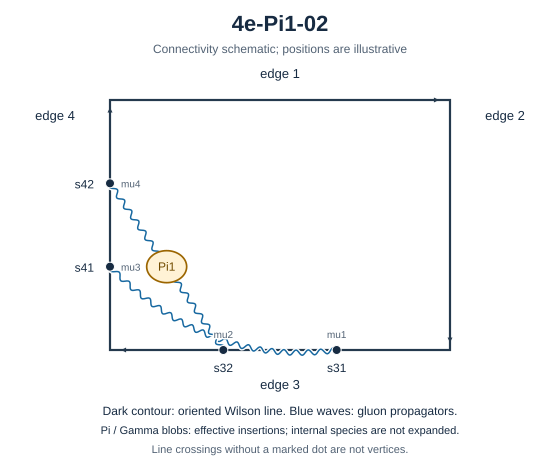

# 4e-Pi1-02

Family: Pi1. Native Hlog arguments and the integral meaning of `rho` are retained. The scale logarithm L enters only after multiplying the sum by S3.

[Original source result](sources/benchmarks/self-energy/pi1/results/4e-Pi1-02/r002.json) · [Complete raw ledger](diagram-ledger.json) · [Conventions](conventions.md)

## Native coefficients

The exact original field, zero provenance and raw syntax are recorded in `native_unweighted` in the ledger. The normalized expressions below do not apply a new r-to-z transformation.

### Native coefficient of $\epsilon^{-6}$

\[
0
\]
### Native coefficient of $\epsilon^{-5}$

\[
- \frac{1}{576}
\]
### Native coefficient of $\epsilon^{-4}$

\[
- \frac{1}{576}
\]
### Native coefficient of $\epsilon^{-3}$

\[
- \frac{1}{192} - \frac{\pi^{2}}{2304}
\]
### Native coefficient of $\epsilon^{-2}$

\[
- \frac{5}{576} - \frac{\pi^{2}}{2304} - \frac{\zeta\left(3\right)}{576}
\]
### Native coefficient of $\epsilon^{-1}$

\[
- \frac{11}{576} - \frac{\pi^{2}}{768} - \frac{19 \pi^{4}}{276480} - \frac{\zeta\left(3\right)}{576}
\]
### Native coefficient of $\epsilon^{0}$

\[
\begin{aligned}& - \frac{7}{192} - \frac{5 \pi^{2}}{2304} - \frac{19 \pi^{4}}{276480} - \frac{\zeta\left(3\right)}{192} - \frac{\pi^{2} \zeta\left(3\right)}{2304}\\ & {} - \frac{\zeta\left(5\right)}{960}\end{aligned}
\]
## Af color-weighted contribution

Each coefficient is after the declared external multiplier/convolution and before S3.

### Weighted coefficient of $\epsilon^{-6}$

\[
0
\]
### Weighted coefficient of $\epsilon^{-5}$

\[
\frac{1}{216}
\]
### Weighted coefficient of $\epsilon^{-4}$

\[
\frac{1}{324}
\]
### Weighted coefficient of $\epsilon^{-3}$

\[
\frac{11}{972} + \frac{\pi^{2}}{864}
\]
### Weighted coefficient of $\epsilon^{-2}$

\[
\frac{\zeta\left(3\right)}{216} + \frac{\pi^{2}}{1296} + \frac{49}{2916}
\]
### Weighted coefficient of $\epsilon^{-1}$

\[
\frac{\zeta\left(3\right)}{324} + \frac{19 \pi^{4}}{103680} + \frac{11 \pi^{2}}{3888} + \frac{341}{8748}
\]
### Weighted coefficient of $\epsilon^{0}$

\[
\begin{aligned}& \frac{\zeta\left(5\right)}{360} + \frac{19 \pi^{4}}{155520} + \frac{11 \zeta\left(3\right)}{972} + \frac{\pi^{2} \zeta\left(3\right)}{864} + \frac{49 \pi^{2}}{11664}\\ & {} + \frac{1897}{26244}\end{aligned}
\]
