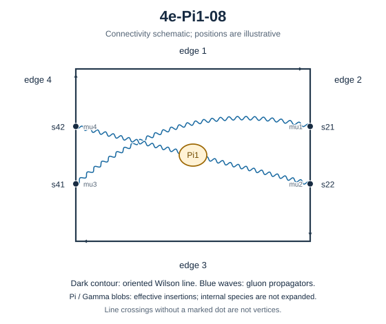

# 4e-Pi1-08

Family: Pi1. Native Hlog arguments and the integral meaning of `rho` are retained. The scale logarithm L enters only after multiplying the sum by S3.

[Original source result](sources/benchmarks/self-energy/pi1/results/4e-Pi1-08/r002.json) · [Complete raw ledger](diagram-ledger.json) · [Conventions](conventions.md)

## Native coefficients

The exact original field, zero provenance and raw syntax are recorded in `native_unweighted` in the ledger. The normalized expressions below do not apply a new r-to-z transformation.

### Native coefficient of $\epsilon^{-6}$

\[
0
\]
### Native coefficient of $\epsilon^{-5}$

\[
0
\]
### Native coefficient of $\epsilon^{-4}$

\[
0
\]
### Native coefficient of $\epsilon^{-3}$

\[
0
\]
### Native coefficient of $\epsilon^{-2}$

\[
0
\]
### Native coefficient of $\epsilon^{-1}$

\[
\begin{aligned}& \frac{\pi^{2} G(-1;z)}{256} + \frac{G(-1,0,0;z)}{128} - \frac{\rho^{4}}{1536} - \frac{\rho^{3}}{1536} - \frac{\pi^{2} \rho^{2}}{768} - \frac{\pi^{2} \rho}{512}\\ & {} - \frac{\pi^{4}}{1536} + \frac{\zeta\left(3\right)}{128}\end{aligned}
\]
### Native coefficient of $\epsilon^{0}$

\[
\begin{aligned}& \frac{3 \pi^{2} G(0,0,-1;z)}{256} + \frac{3 G(0,0,-1,0,0;z)}{128} + \frac{\pi^{2} G(0,-1;z)}{128} - \frac{\pi^{2} G(0,-1,0;z)}{256} + \frac{G(0,-1,0,0;z)}{64}\\ & {} - \frac{3 G(0,-1,0,0,0;z)}{128} - \frac{G(-1;z) \zeta\left(3\right)}{32} + \frac{\pi^{2} G(-1;z)}{256} + \frac{\pi^{4} G(-1;z)}{512} + \frac{\pi^{2} G(-1,0;z)}{128}\\ & {} + \frac{G(-1,0,0;z)}{128} + \frac{\pi^{2} G(-1,0,0;z)}{128} + \frac{G(-1,0,0,0;z)}{64} + \frac{3 G(-1,0,0,0,0;z)}{64} - \frac{\pi^{2} G(-1,-1;z)}{64}\\ & {} - \frac{G(-1,-1,0,0;z)}{32} - \frac{\rho^{5}}{5120} - \frac{\rho^{4}}{768} - \frac{\pi^{2} \rho^{3}}{768} - \frac{\rho^{3}}{1536}\\ & {} - \frac{9 \rho^{2} \zeta\left(3\right)}{256} - \frac{13 \pi^{2} \rho^{2}}{3072} - \frac{49 \pi^{4} \rho}{15360} - \frac{\pi^{2} \rho}{512}\\ & {} + \frac{\rho \zeta\left(3\right)}{64} - \frac{17 \pi^{2} \zeta\left(3\right)}{256} - \frac{41 \pi^{4}}{15360} + \frac{\zeta\left(3\right)}{128}\\ & {} + \frac{9 \zeta\left(5\right)}{32}\end{aligned}
\]
## Af color-weighted contribution

Each coefficient is after the declared external multiplier/convolution and before S3.

### Weighted coefficient of $\epsilon^{-6}$

\[
0
\]
### Weighted coefficient of $\epsilon^{-5}$

\[
0
\]
### Weighted coefficient of $\epsilon^{-4}$

\[
0
\]
### Weighted coefficient of $\epsilon^{-3}$

\[
0
\]
### Weighted coefficient of $\epsilon^{-2}$

\[
0
\]
### Weighted coefficient of $\epsilon^{-1}$

\[
\begin{aligned}& - \frac{\pi^{2} G(-1;z)}{96} - \frac{G(-1,0,0;z)}{48} + \frac{\rho^{4}}{576} + \frac{\rho^{3}}{576} + \frac{\pi^{2} \rho^{2}}{288} + \frac{\pi^{2} \rho}{192}\\ & {} - \frac{\zeta\left(3\right)}{48} + \frac{\pi^{4}}{576}\end{aligned}
\]
### Weighted coefficient of $\epsilon^{0}$

\[
\begin{aligned}& - \frac{\pi^{2} G(0,0,-1;z)}{32} - \frac{G(0,0,-1,0,0;z)}{16} - \frac{\pi^{2} G(0,-1;z)}{48} + \frac{\pi^{2} G(0,-1,0;z)}{96} - \frac{G(0,-1,0,0;z)}{24}\\ & {} + \frac{G(0,-1,0,0,0;z)}{16} - \frac{\pi^{4} G(-1;z)}{192} - \frac{\pi^{2} G(-1;z)}{144} + \frac{G(-1;z) \zeta\left(3\right)}{12} - \frac{\pi^{2} G(-1,0;z)}{48}\\ & {} - \frac{\pi^{2} G(-1,0,0;z)}{48} - \frac{G(-1,0,0;z)}{72} - \frac{G(-1,0,0,0;z)}{24} - \frac{G(-1,0,0,0,0;z)}{8} + \frac{\pi^{2} G(-1,-1;z)}{24}\\ & {} + \frac{G(-1,-1,0,0;z)}{12} + \frac{\rho^{5}}{1920} + \frac{5 \rho^{4}}{1728} + \frac{\rho^{3}}{864} + \frac{\pi^{2} \rho^{3}}{288} + \frac{35 \pi^{2} \rho^{2}}{3456}\\ & {} + \frac{3 \rho^{2} \zeta\left(3\right)}{32} - \frac{\rho \zeta\left(3\right)}{24} + \frac{\pi^{2} \rho}{288} + \frac{49 \pi^{4} \rho}{5760}\\ & {} - \frac{3 \zeta\left(5\right)}{4} - \frac{\zeta\left(3\right)}{72} + \frac{113 \pi^{4}}{17280} + \frac{17 \pi^{2} \zeta\left(3\right)}{96}\end{aligned}
\]
