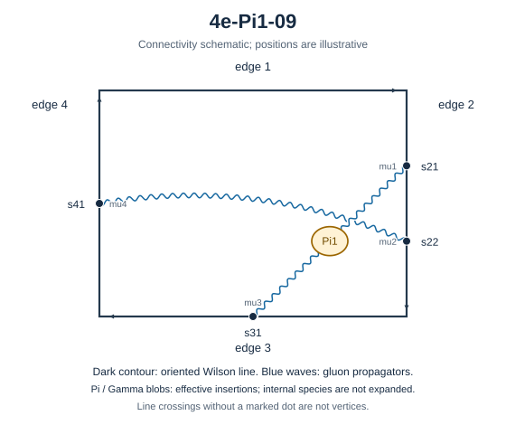

# 4e-Pi1-09

Family: Pi1. Native Hlog arguments and the integral meaning of `rho` are retained. The scale logarithm L enters only after multiplying the sum by S3.

[Original source result](sources/benchmarks/self-energy/pi1/results/4e-Pi1-09/r002.json) · [Complete raw ledger](diagram-ledger.json) · [Conventions](conventions.md)

## Native coefficients

The exact original field, zero provenance and raw syntax are recorded in `native_unweighted` in the ledger. The normalized expressions below do not apply a new r-to-z transformation.

### Native coefficient of $\epsilon^{-6}$

\[
0
\]
### Native coefficient of $\epsilon^{-5}$

\[
0
\]
### Native coefficient of $\epsilon^{-4}$

\[
0
\]
### Native coefficient of $\epsilon^{-3}$

\[
0
\]
### Native coefficient of $\epsilon^{-2}$

\[
\frac{\pi^{2} G(-1;z)}{128} + \frac{G(-1,0,0;z)}{64} - \frac{\rho^{3}}{768} - \frac{\pi^{2} \rho}{256} + \frac{\zeta\left(3\right)}{64}
\]
### Native coefficient of $\epsilon^{-1}$

\[
\begin{aligned}& \frac{\pi^{2} G(0,-1;z)}{64} + \frac{G(0,-1,0,0;z)}{32} - \frac{G(-1;z) \zeta\left(3\right)}{16} + \frac{\pi^{2} G(-1;z)}{128} + \frac{\pi^{2} G(-1,0;z)}{64}\\ & {} + \frac{G(-1,0,0;z)}{64} + \frac{G(-1,0,0,0;z)}{32} - \frac{\pi^{2} G(-1,-1;z)}{32} - \frac{G(-1,-1,0,0;z)}{16} + \frac{\rho^{4}}{3072} - \frac{\rho^{3}}{768}\\ & {} - \frac{\pi^{2} \rho^{2}}{384} - \frac{\pi^{2} \rho}{256} + \frac{\rho \zeta\left(3\right)}{32} - \frac{37 \pi^{4}}{15360} + \frac{\zeta\left(3\right)}{64}\end{aligned}
\]
### Native coefficient of $\epsilon^{0}$

\[
\begin{aligned}& \frac{\pi^{2} G(0,0,-1;z)}{256} + \frac{G(0,0,-1,0,0;z)}{128} - \frac{13 G(0,-1;z) \zeta\left(3\right)}{128} + \frac{\pi^{2} G(0,-1;z)}{64}\\ & {} + \frac{\pi^{2} G(0,-1,0;z)}{256} + \frac{G(0,-1,0,0;z)}{32} - \frac{5 G(0,-1,0,0,0;z)}{64} - \frac{13 \pi^{2} G(0,-1,-1;z)}{256} - \frac{13 G(0,-1,-1,0,0;z)}{128}\\ & {} - \frac{G(-1;z) \zeta\left(3\right)}{16} + \frac{3 \pi^{2} G(-1;z)}{128} + \frac{149 \pi^{4} G(-1;z)}{15360} - \frac{13 G(-1,0;z) \zeta\left(3\right)}{128}\\ & {} + \frac{\pi^{2} G(-1,0;z)}{64} + \frac{3 G(-1,0,0;z)}{64} + \frac{3 \pi^{2} G(-1,0,0;z)}{256} + \frac{G(-1,0,0,0;z)}{32} - \frac{17 G(-1,0,0,0,0;z)}{128}\\ & {} - \frac{13 \pi^{2} G(-1,0,-1;z)}{256} - \frac{13 G(-1,0,-1,0,0;z)}{128} - \frac{\pi^{2} G(-1,-1;z)}{32} + \frac{13 G(-1,-1;z) \zeta\left(3\right)}{64}\\ & {} - \frac{13 \pi^{2} G(-1,-1,0;z)}{256} - \frac{G(-1,-1,0,0;z)}{16} - \frac{13 G(-1,-1,0,0,0;z)}{128} + \frac{13 \pi^{2} G(-1,-1,-1;z)}{128}\\ & {} + \frac{13 G(-1,-1,-1,0,0;z)}{64} + \frac{13 \rho^{5}}{10240} + \frac{\rho^{4}}{3072} - \frac{\rho^{3}}{256} + \frac{\pi^{2} \rho^{3}}{384}\\ & {} - \frac{\pi^{2} \rho^{2}}{384} + \frac{\rho^{2} \zeta\left(3\right)}{64} - \frac{149 \pi^{4} \rho}{30720} - \frac{3 \pi^{2} \rho}{256}\\ & {} + \frac{\rho \zeta\left(3\right)}{32} - \frac{37 \pi^{4}}{15360} + \frac{3 \zeta\left(3\right)}{64} + \frac{\pi^{2} \zeta\left(3\right)}{128}\\ & {} + \frac{29 \zeta\left(5\right)}{128}\end{aligned}
\]
## Af color-weighted contribution

Each coefficient is after the declared external multiplier/convolution and before S3.

### Weighted coefficient of $\epsilon^{-6}$

\[
0
\]
### Weighted coefficient of $\epsilon^{-5}$

\[
0
\]
### Weighted coefficient of $\epsilon^{-4}$

\[
0
\]
### Weighted coefficient of $\epsilon^{-3}$

\[
0
\]
### Weighted coefficient of $\epsilon^{-2}$

\[
- \frac{\pi^{2} G(-1;z)}{48} - \frac{G(-1,0,0;z)}{24} + \frac{\rho^{3}}{288} + \frac{\pi^{2} \rho}{96} - \frac{\zeta\left(3\right)}{24}
\]
### Weighted coefficient of $\epsilon^{-1}$

\[
\begin{aligned}& - \frac{\pi^{2} G(0,-1;z)}{24} - \frac{G(0,-1,0,0;z)}{12} - \frac{\pi^{2} G(-1;z)}{72} + \frac{G(-1;z) \zeta\left(3\right)}{6} - \frac{\pi^{2} G(-1,0;z)}{24}\\ & {} - \frac{G(-1,0,0;z)}{36} - \frac{G(-1,0,0,0;z)}{12} + \frac{\pi^{2} G(-1,-1;z)}{12} + \frac{G(-1,-1,0,0;z)}{6} - \frac{\rho^{4}}{1152} + \frac{\rho^{3}}{432}\\ & {} + \frac{\pi^{2} \rho^{2}}{144} - \frac{\rho \zeta\left(3\right)}{12} + \frac{\pi^{2} \rho}{144} - \frac{\zeta\left(3\right)}{36} + \frac{37 \pi^{4}}{5760}\end{aligned}
\]
### Weighted coefficient of $\epsilon^{0}$

\[
\begin{aligned}& - \frac{\pi^{2} G(0,0,-1;z)}{96} - \frac{G(0,0,-1,0,0;z)}{48} - \frac{\pi^{2} G(0,-1;z)}{36} + \frac{13 G(0,-1;z) \zeta\left(3\right)}{48}\\ & {} - \frac{\pi^{2} G(0,-1,0;z)}{96} - \frac{G(0,-1,0,0;z)}{18} + \frac{5 G(0,-1,0,0,0;z)}{24} + \frac{13 \pi^{2} G(0,-1,-1;z)}{96} + \frac{13 G(0,-1,-1,0,0;z)}{48}\\ & {} - \frac{149 \pi^{4} G(-1;z)}{5760} - \frac{11 \pi^{2} G(-1;z)}{216} + \frac{G(-1;z) \zeta\left(3\right)}{9} - \frac{\pi^{2} G(-1,0;z)}{36}\\ & {} + \frac{13 G(-1,0;z) \zeta\left(3\right)}{48} - \frac{\pi^{2} G(-1,0,0;z)}{32} - \frac{11 G(-1,0,0;z)}{108} - \frac{G(-1,0,0,0;z)}{18} + \frac{17 G(-1,0,0,0,0;z)}{48}\\ & {} + \frac{13 \pi^{2} G(-1,0,-1;z)}{96} + \frac{13 G(-1,0,-1,0,0;z)}{48} - \frac{13 G(-1,-1;z) \zeta\left(3\right)}{24} + \frac{\pi^{2} G(-1,-1;z)}{18}\\ & {} + \frac{13 \pi^{2} G(-1,-1,0;z)}{96} + \frac{G(-1,-1,0,0;z)}{9} + \frac{13 G(-1,-1,0,0,0;z)}{48} - \frac{13 \pi^{2} G(-1,-1,-1;z)}{48} - \frac{13 G(-1,-1,-1,0,0;z)}{24}\\ & {} - \frac{13 \rho^{5}}{3840} - \frac{\rho^{4}}{1728} - \frac{\pi^{2} \rho^{3}}{144} + \frac{11 \rho^{3}}{1296} - \frac{\rho^{2} \zeta\left(3\right)}{24}\\ & {} + \frac{\pi^{2} \rho^{2}}{216} - \frac{\rho \zeta\left(3\right)}{18} + \frac{11 \pi^{2} \rho}{432} + \frac{149 \pi^{4} \rho}{11520} - \frac{29 \zeta\left(5\right)}{48}\\ & {} - \frac{\pi^{2} \zeta\left(3\right)}{48} - \frac{11 \zeta\left(3\right)}{108} + \frac{37 \pi^{4}}{8640}\end{aligned}
\]
