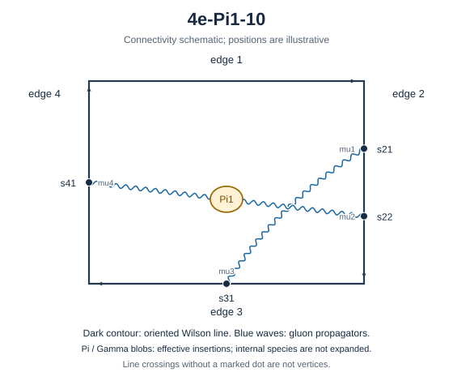

# 4e-Pi1-10

Family: Pi1. Native Hlog arguments and the integral meaning of `rho` are retained. The scale logarithm L enters only after multiplying the sum by S3.

[Original source result](sources/benchmarks/self-energy/pi1/results/4e-Pi1-10/r002.json) · [Complete raw ledger](diagram-ledger.json) · [Conventions](conventions.md)

## Native coefficients

The exact original field, zero provenance and raw syntax are recorded in `native_unweighted` in the ledger. The normalized expressions below do not apply a new r-to-z transformation.

### Native coefficient of $\epsilon^{-6}$

\[
0
\]
### Native coefficient of $\epsilon^{-5}$

\[
0
\]
### Native coefficient of $\epsilon^{-4}$

\[
- \frac{1}{384}
\]
### Native coefficient of $\epsilon^{-3}$

\[
- \frac{1}{384}
\]
### Native coefficient of $\epsilon^{-2}$

\[
\begin{aligned}& \frac{\pi^{2} G(-1;z)}{64} + \frac{G(-1,0,0;z)}{32} - \frac{\rho^{3}}{384} - \frac{\pi^{2} \rho}{128} - \frac{5 \pi^{2}}{1536} - \frac{1}{128}\\ & {} + \frac{\zeta\left(3\right)}{32}\end{aligned}
\]
### Native coefficient of $\epsilon^{-1}$

\[
\begin{aligned}& \frac{5 \pi^{2} G(0,-1;z)}{128} + \frac{5 G(0,-1,0,0;z)}{64} - \frac{5 G(-1;z) \zeta\left(3\right)}{32} + \frac{\pi^{2} G(-1;z)}{32} + \frac{5 \pi^{2} G(-1,0;z)}{128}\\ & {} + \frac{G(-1,0,0;z)}{16} + \frac{5 G(-1,0,0,0;z)}{64} - \frac{5 \pi^{2} G(-1,-1;z)}{64} - \frac{5 G(-1,-1,0,0;z)}{32} - \frac{\rho^{4}}{1536} - \frac{\rho^{3}}{192}\\ & {} - \frac{5 \pi^{2} \rho^{2}}{768} - \frac{\pi^{2} \rho}{64} + \frac{5 \rho \zeta\left(3\right)}{64} - \frac{7 \pi^{4}}{1536} - \frac{5 \pi^{2}}{1536} - \frac{5}{384}\\ & {} + \frac{41 \zeta\left(3\right)}{384}\end{aligned}
\]
### Native coefficient of $\epsilon^{0}$

\[
\begin{aligned}& \frac{\pi^{2} G(0,0,-1;z)}{32} + \frac{G(0,0,-1,0,0;z)}{16} - \frac{19 G(0,-1;z) \zeta\left(3\right)}{64} + \frac{5 \pi^{2} G(0,-1;z)}{64}\\ & {} + \frac{\pi^{2} G(0,-1,0;z)}{32} + \frac{5 G(0,-1,0,0;z)}{32} - \frac{7 G(0,-1,0,0,0;z)}{64} - \frac{19 \pi^{2} G(0,-1,-1;z)}{128} - \frac{19 G(0,-1,-1,0,0;z)}{64}\\ & {} - \frac{5 G(-1;z) \zeta\left(3\right)}{16} + \frac{\pi^{2} G(-1;z)}{16} + \frac{167 \pi^{4} G(-1;z)}{7680} - \frac{19 G(-1,0;z) \zeta\left(3\right)}{64}\\ & {} + \frac{5 \pi^{2} G(-1,0;z)}{64} + \frac{G(-1,0,0;z)}{8} + \frac{\pi^{2} G(-1,0,0;z)}{32} + \frac{5 G(-1,0,0,0;z)}{32} - \frac{17 G(-1,0,0,0,0;z)}{64}\\ & {} - \frac{19 \pi^{2} G(-1,0,-1;z)}{128} - \frac{19 G(-1,0,-1,0,0;z)}{64} - \frac{5 \pi^{2} G(-1,-1;z)}{32} + \frac{19 G(-1,-1;z) \zeta\left(3\right)}{32}\\ & {} - \frac{19 \pi^{2} G(-1,-1,0;z)}{128} - \frac{5 G(-1,-1,0,0;z)}{16} - \frac{19 G(-1,-1,0,0,0;z)}{64} + \frac{19 \pi^{2} G(-1,-1,-1;z)}{64}\\ & {} + \frac{19 G(-1,-1,-1,0,0;z)}{32} + \frac{13 \rho^{5}}{5120} - \frac{\rho^{4}}{768} - \frac{\rho^{3}}{96} + \frac{7 \pi^{2} \rho^{3}}{1536} - \frac{\pi^{2} \rho^{2}}{96}\\ & {} + \frac{\rho^{2} \zeta\left(3\right)}{128} - \frac{167 \pi^{4} \rho}{15360} - \frac{\pi^{2} \rho}{32} + \frac{5 \rho \zeta\left(3\right)}{32} - \frac{133 \pi^{4}}{12288}\\ & {} - \frac{5 \pi^{2}}{512} - \frac{11}{384} + \frac{65 \zeta\left(3\right)}{384} + \frac{35 \zeta\left(5\right)}{64}\end{aligned}
\]
## Af color-weighted contribution

Each coefficient is after the declared external multiplier/convolution and before S3.

### Weighted coefficient of $\epsilon^{-6}$

\[
0
\]
### Weighted coefficient of $\epsilon^{-5}$

\[
0
\]
### Weighted coefficient of $\epsilon^{-4}$

\[
\frac{1}{144}
\]
### Weighted coefficient of $\epsilon^{-3}$

\[
\frac{1}{216}
\]
### Weighted coefficient of $\epsilon^{-2}$

\[
\begin{aligned}& - \frac{\pi^{2} G(-1;z)}{24} - \frac{G(-1,0,0;z)}{12} + \frac{\rho^{3}}{144} + \frac{\pi^{2} \rho}{48} - \frac{\zeta\left(3\right)}{12} + \frac{11}{648}\\ & {} + \frac{5 \pi^{2}}{576}\end{aligned}
\]
### Weighted coefficient of $\epsilon^{-1}$

\[
\begin{aligned}& - \frac{5 \pi^{2} G(0,-1;z)}{48} - \frac{5 G(0,-1,0,0;z)}{24} - \frac{5 \pi^{2} G(-1;z)}{72} + \frac{5 G(-1;z) \zeta\left(3\right)}{12} - \frac{5 \pi^{2} G(-1,0;z)}{48}\\ & {} - \frac{5 G(-1,0,0;z)}{36} - \frac{5 G(-1,0,0,0;z)}{24} + \frac{5 \pi^{2} G(-1,-1;z)}{24} + \frac{5 G(-1,-1,0,0;z)}{12} + \frac{\rho^{4}}{576} + \frac{5 \rho^{3}}{432}\\ & {} + \frac{5 \pi^{2} \rho^{2}}{288} - \frac{5 \rho \zeta\left(3\right)}{24} + \frac{5 \pi^{2} \rho}{144} - \frac{37 \zeta\left(3\right)}{144} + \frac{49}{1944}\\ & {} + \frac{5 \pi^{2}}{864} + \frac{7 \pi^{4}}{576}\end{aligned}
\]
### Weighted coefficient of $\epsilon^{0}$

\[
\begin{aligned}& - \frac{\pi^{2} G(0,0,-1;z)}{12} - \frac{G(0,0,-1,0,0;z)}{6} - \frac{25 \pi^{2} G(0,-1;z)}{144} + \frac{19 G(0,-1;z) \zeta\left(3\right)}{24}\\ & {} - \frac{\pi^{2} G(0,-1,0;z)}{12} - \frac{25 G(0,-1,0,0;z)}{72} + \frac{7 G(0,-1,0,0,0;z)}{24} + \frac{19 \pi^{2} G(0,-1,-1;z)}{48} + \frac{19 G(0,-1,-1,0,0;z)}{24}\\ & {} - \frac{167 \pi^{4} G(-1;z)}{2880} - \frac{7 \pi^{2} G(-1;z)}{54} + \frac{25 G(-1;z) \zeta\left(3\right)}{36} - \frac{25 \pi^{2} G(-1,0;z)}{144}\\ & {} + \frac{19 G(-1,0;z) \zeta\left(3\right)}{24} - \frac{\pi^{2} G(-1,0,0;z)}{12} - \frac{7 G(-1,0,0;z)}{27} - \frac{25 G(-1,0,0,0;z)}{72} + \frac{17 G(-1,0,0,0,0;z)}{24}\\ & {} + \frac{19 \pi^{2} G(-1,0,-1;z)}{48} + \frac{19 G(-1,0,-1,0,0;z)}{24} - \frac{19 G(-1,-1;z) \zeta\left(3\right)}{12} + \frac{25 \pi^{2} G(-1,-1;z)}{72}\\ & {} + \frac{19 \pi^{2} G(-1,-1,0;z)}{48} + \frac{25 G(-1,-1,0,0;z)}{36} + \frac{19 G(-1,-1,0,0,0;z)}{24} - \frac{19 \pi^{2} G(-1,-1,-1;z)}{24}\\ & {} - \frac{19 G(-1,-1,-1,0,0;z)}{12} - \frac{13 \rho^{5}}{1920} + \frac{5 \rho^{4}}{1728} - \frac{7 \pi^{2} \rho^{3}}{576} + \frac{7 \rho^{3}}{324}\\ & {} - \frac{\rho^{2} \zeta\left(3\right)}{48} + \frac{19 \pi^{2} \rho^{2}}{864} - \frac{25 \rho \zeta\left(3\right)}{72} + \frac{7 \pi^{2} \rho}{108}\\ & {} + \frac{167 \pi^{4} \rho}{5760} - \frac{35 \zeta\left(5\right)}{24} - \frac{73 \zeta\left(3\right)}{216} + \frac{341}{5832} + \frac{55 \pi^{2}}{2592}\\ & {} + \frac{343 \pi^{4}}{13824}\end{aligned}
\]
